# Grimora Engine

Motor 3D próprio, escrito em **Rust**, para jogos low poly com visual dark fantasy estilizado. Construído para ser desenvolvido junto com IA: cenas em arquivos legíveis, recarga automática, capturas de tela e métricas pela linha de comando.


## Começando

Requisitos: Windows 10/11, GPU com Vulkan ou DirectX 12, [Rust](https://rustup.rs) estável.

```bash
cargo run -p sandbox
```

Você controla um personagem low poly com espada e lanterna:

| Tecla | Modo personagem (padrão) | Modo voo (**Tab** alterna) |
| --- | --- | --- |
| Mouse | gira a câmera | segure o botão direito para olhar |
| WASD | anda relativo à câmera | voa |
| Shift | corre | acelera |
| Espaço | pula | sobe (E/Q também) |
| Roda | aproxima/afasta a câmera | ajusta a velocidade |
| E | usa o objeto ao alcance | sobe |
| Clique ou F | golpeia com o cajado | |
| Gamepad | todos os comandos do personagem | |

**F5** recarrega a cena, **F6** salva o jogo, **F9** carrega o último save, **F12** salva uma captura em `screenshots/`, **Esc** abre a pausa.

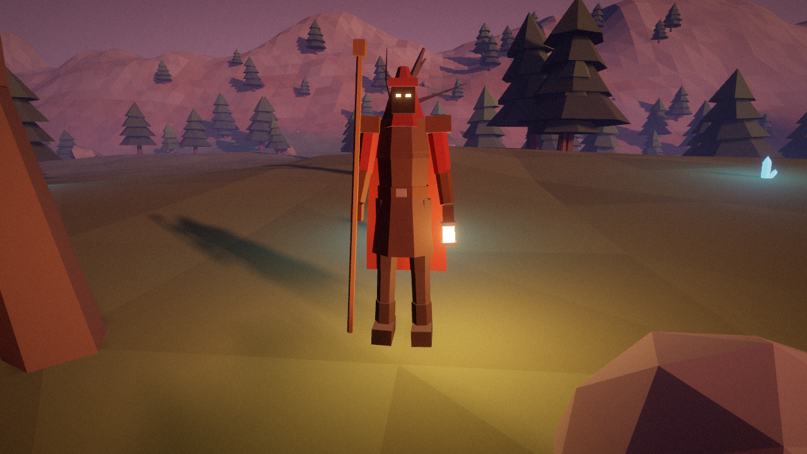

Com o jogo aberto, edite [assets/scenes/sandbox.ron](assets/scenes/sandbox.ron) e salve: a cena recarrega na hora. Se o arquivo tiver um erro, o motor mostra linha e coluna no terminal e continua com a versão anterior.

### Linha de comando (para automação e IA)

```bash
cargo run -p sandbox -- --screenshot screenshots/teste.png
```

```bash
cargo run -p sandbox -- --screenshot shots/vista.png --camera -13,5,-15 --look-at 0,1,0 --size 1280x720
```

```bash
cargo run --release -p sandbox -- --frames 600 --no-vsync
```

| Opção | Efeito |
| --- | --- |
| `--scene <arquivo.ron>` | Cena a carregar |
| `--screenshot <arquivo.png>` | Renderiza, salva a imagem e fecha |
| `--frames <n>` | Fecha após n quadros (padrão 90 com `--screenshot`) |
| `--camera x,y,z` / `--look-at x,y,z` | Posiciona a câmera (Y absoluto; no sandbox, ativa o modo voo) |
| `--size LxA` | Tamanho da janela |
| `--no-vsync`, `--no-msaa`, `--no-hot-reload` | Benchmark e depuração |
| `--no-audio` | Sem som (com `--screenshot` o áudio já roda mudo, sem abrir o dispositivo) |
| `--no-ui` | Esconde o HUD do jogo (capturas só da cena) |
| `--save-dir <pasta>` | Pasta dos saves (padrão: `%APPDATA%\<título do jogo>\saves`) |
| `--load <slot>` | Pede ao jogo para carregar esse save ao abrir (o sandbox atende) |
| `--menu <nome>` | Pede ao jogo para abrir esse menu, para captura (o sandbox atende `title`, `pause`, `options`, `video` e `controls`) |
| `--time <hora>` | Trava o dia da cena nessa hora, de 0 a 24 |

Ao fechar, o motor imprime uma linha de métricas fácil de ler por scripts:

```
[grimora] frames=80 avg_ms=5.56 p95_ms=5.88 max_ms=5.91 draw_calls=47 objects=151 culled=249 shadow_casters=305 triangles=28220 particles=340 gpu="NVIDIA GeForce RTX 3060"
```

`objects` são os objetos desenhados na tela, `culled` os que ficaram de fora (fora da câmera ou pequenos demais) e `shadow_casters` os desenhados no mapa de sombra. `particles` são as partículas vivas.

## Arquitetura

```
crates/
  grimora_core/    tempo, entrada, Transform, Camera, MeshData, Material, Environment (luz/névoa/céu/pós), simulação de partículas
  grimora_render/  renderizador wgpu: sombras, HDR + MSAA 4x, materiais PBR, névoa de altura, partículas, bloom, tonemapping, HUD
  grimora_scene/   formato de cena RON, importação glTF, terreno procedural, geradores low poly, espalhamento, colisores
  grimora_physics/ física com Rapier: mundo estático da cena, corpos dinâmicos, raycasts, corpo de personagem (cápsula), busca de caminhos
  grimora_audio/   som com kira: efeitos, loops de ambiente e emissores 3D que seguem a câmera
  grimora/         janela (winit), laço principal, trait Game, World (entidades hecs), gatilhos e interação, partículas, NPCs, combate, FlyCamera, ThirdPersonController, CLI, hot-reload
examples/
  sandbox/         cena de teste do motor
assets/scenes/     cenas .ron
assets/models/     modelos glTF (com a licença de cada um)
assets/sounds/     sons WAV/OGG (os do sandbox são gerados por tools/gen_sounds.py)
assets/textures/   texturas e sprites em pixel art, parte do motor (importadas por tools/import_textures.py)
```

Quadro a quadro: mapa de sombra do sol ou da lua → passe HDR (céu + malhas iluminadas + transparentes e água + partículas ordenadas, MSAA) → cadeia de bloom → tonemap ACES, contraste, saturação, vinheta e granulado na tela → HUD por cima. Objetos com a mesma malha são desenhados numa única chamada instanciada.

| Componente | Escolha |
| --- | --- |
| Gráficos | `wgpu` 30 (Vulkan/DX12) com shaders WGSL |
| Janela e entrada | `winit` 0.30 |
| Matemática | `glam` 0.34 |
| Física e colisão | `rapier3d` 0.36 |
| Entidades | `hecs` 0.11 |
| Cenas | `ron` + `serde` |
| Modelos | `gltf` 1.4 |
| Áudio | `kira` 0.12 (WAV e OGG) |
| Fonte do HUD | glifos 8x8 do `font8x8` (domínio público) |

### Criando um jogo

```rust
use grimora::prelude::*;

#[derive(Default)]
struct MeuJogo { jogador: Option<ThirdPersonController> }

impl Game for MeuJogo {
    fn scene_loaded(&mut self, ctx: &mut Context) {
        let inicio = ctx.world.player_spawn.expect("a cena define `player`");
        self.jogador = Some(ThirdPersonController::new(inicio.position, inicio.yaw));
    }

    fn update(&mut self, ctx: &mut Context) {
        let Some(jogador) = &mut self.jogador else { return };
        // Anda, pula e colide com a cena; a câmera segue sem atravessar paredes.
        jogador.update(&ctx.input, &mut ctx.physics, &mut ctx.camera, ctx.time.delta());
        ctx.set_cursor_grab(true);
        if let Some(altar) = ctx.world.find("altar")
            && let Some(transform) = ctx.world.get_mut::<Transform>(altar)
        {
            transform.rotation = Quat::from_rotation_y(ctx.time.elapsed());
        }
    }
}

fn main() -> anyhow::Result<()> {
    let config = EngineConfig { scene: Some("assets/scenes/minha_cena.ron".into()), ..Default::default() };
    grimora::run(config.with_cli()?, MeuJogo::default())
}
```

### Entidades e componentes

Cada objeto do mundo é uma entidade do [`hecs`](https://docs.rs/hecs) em `ctx.world.ecs`. O motor usa estes componentes:

| Componente | Para quê |
| --- | --- |
| `Transform` | posição, rotação e escala |
| `Renderable` | malha, cor, emissão e `visible` |
| `Name` | o `name:` da cena (`World::find`) |
| `Light` | luz pontual que acompanha a entidade |
| `Animator` | esqueleto animado |
| `Trigger` | área que avisa quando o jogador entra ou sai |
| `Interactable` | objeto que o jogador usa com uma tecla |
| `ParticleSystem` | efeito de partículas que sai da entidade |
| `Agent` / `Brain` | personagem que anda sozinho e o que decide para onde |
| `Health` / `Fighter` | o que pode ser ferido e o que pode golpear |
| `Body` / `Collider` | corpo dinâmico ou colisor estático na física |
| `SceneIndex` | posição no `objects` da cena (usado pelo save) |

O jogo pendura os próprios componentes e consulta tudo junto:

```rust
struct Vida(u32);

let goblin = ctx.world.spawn(malha, Transform::from_position(Vec3::new(4.0, 0.0, -2.0)));
ctx.world.ecs.insert_one(goblin, Vida(10)).unwrap(); // acabou de nascer

for (transform, vida) in ctx.world.ecs.query_mut::<(&mut Transform, &mut Vida)>() {
    // ...
}
if ctx.world.get::<Vida>(goblin).is_some_and(|v| v.0 == 0) {
    ctx.world.despawn(goblin, &mut ctx.physics); // tira o colisor ou corpo junto
}
```

- Um `Entity` vale até a entidade ser removida, e um id removido nunca aponta para outra entidade: guarde-os à vontade.
- Remova entidades com física por `World::despawn`, que tira o colisor ou corpo do Rapier; `ecs.despawn` direto deixaria o colisor para trás.
- Luzes: `light:` num objeto da cena vira o componente `Light` (deslocamento girado com a entidade, sem escala). Para prender uma luz a um osso, crie uma entidade `(Transform, Light(...))` e copie `joint_transform` para o `Transform` dela. `World::lights` guarda só as luzes soltas.
- Cada (re)carga da cena recria todas as entidades; `Game::scene_loaded` é o lugar de achá-las de novo.

### Formato de cena

Tudo é dado: ambiente (sol, luz ambiente, névoa, céu, sombras, pós-processamento), câmera, ponto de início do jogador, terreno, objetos, espalhamento aleatório com semente, luzes pontuais e gatilhos. Todo objeto colide automaticamente com uma forma adequada (tronco para árvores, casco convexo para rochas e pilares, malha exata para o terreno); use `collider: None` para decoração ou escolha `Box(...)`, `Cylinder(...)`, `Ball(...)`, `Hull` ou `Mesh`. Com `body: Dynamic(...)` o objeto entra na simulação: cai, rola e é empurrado pelo personagem; campos opcionais `density` (kg/m³, padrão 1000) ou `mass` (kg), `friction` (0.6), `restitution` (0) e `angular_damping` (0.5). Malhas exatas viram casco convexo em corpos dinâmicos. Cores em sRGB 0..1, ângulos em graus, distâncias em metros. Malhas disponíveis: `Cube`, `Plane`, `Cylinder`, `Cone`, `Sphere`, `Pine`, `DeadTree`, `Rock`, `Crystal`, `Pillar`, `Wanderer` e `Model(path: "...")`. Veja o exemplo comentado em [sandbox.ron](assets/scenes/sandbox.ron).

### Modelos glTF

Exporte do Blender como glTF 2.0 (`.gltf` + `.bin` + texturas, ou `.glb`) para `assets/models/` e use na cena:

```ron
(mesh: Model(path: "../models/banner/banner.gltf"), position: (-2.6, 0.0, 9.0), rotation: (0.0, 15.0, 0.0)),
```


- O caminho é relativo ao arquivo de cena. Se o arquivo faltar ou estiver quebrado, o erro vai para o log e aparece um cubo magenta no lugar.
- A cena inteira do arquivo vira uma malha: transformações dos nós são aplicadas e cada primitiva vira uma submalha com seu material.
- Materiais metallic-roughness: cor base, normal map, metal/rugosidade, oclusão, emissão (`emissiveFactor`, `emissiveTexture` e `KHR_materials_emissive_strength`) e `doubleSided`. Cores de vértice também são lidas. Faltando normais ou tangentes, o motor gera.
- Emissão acima de 1 alimenta o bloom: no Blender, aumente a força (Strength) do Emission para a runa ou brasa brilhar.
- Transparência (`alphaMode`): `MASK` recorta o que estiver abaixo do `alphaCutoff` (folhagem, pano rasgado, grades), com bordas suavizadas pelo MSAA (alpha-to-coverage) e recorte também na sombra. `BLEND` é aproximado por alpha-to-coverage: não precisa ordenar objetos, mas tem poucos níveis de transparência e um leve pontilhado; para vidro e água de verdade ainda falta mistura ordenada em malhas (por enquanto, só as partículas têm).
- Texturas maiores que `max_texture_size` (padrão 2048) são reduzidas pela metade até caber: `Model(path: "...", max_texture_size: 1024)`.
- O modelo mantém a origem e a escala do arquivo. O colisor automático é o casco convexo; use `collider: Mesh` para formas côncavas grandes (casas, ruínas) ou `None` para decoração.
- Modelos ficam em cache enquanto o arquivo não muda, então o hot-reload da cena é instantâneo. Editar só o modelo não recarrega a cena: salve o `.ron` para recarregar.
- Ainda não suportados: mistura de transparência ordenada em malhas, morph targets e um segundo conjunto de UVs.
- O estandarte do sandbox é gerado por [tools/gen_banner.py](tools/gen_banner.py) (Python puro), um exemplo de como criar um glTF por código.

### Animação esquelética

Modelos glTF com esqueleto (skin) e animações tocam direto: o skinning roda na GPU (até 4 ossos por vértice) e cada objeto animado ganha um `Animator`.

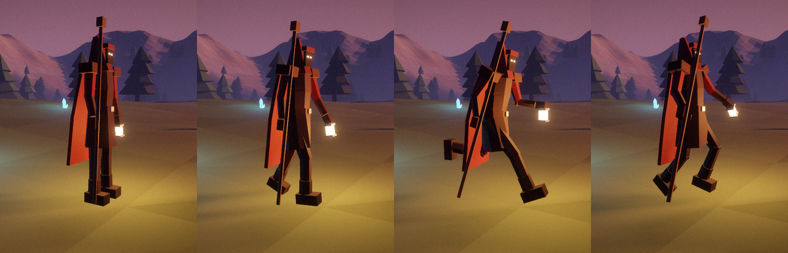

```ron
(mesh: Model(path: "../models/wanderer/wanderer.gltf"), position: (5.6, 0.0, 8.4), animation: "idle"),
```

```rust
// No jogo: escolha o clipe pelo movimento; a troca faz crossfade.
if let Some(animator) = ctx.world.get_mut::<Animator>(avatar) {
    animator.play(if correndo { "run" } else { "walk" }, 0.2);
    animator.speed = velocidade / 4.5; // pés sem deslizar
}
// Prenda coisas aos ossos (luz, arma, partículas): transformação no mundo.
// `tocha` é uma entidade com `Transform` e `Light`.
if let Some(mao) = ctx.world.joint_transform(avatar, "hand.L")
    && let Some(transform) = ctx.world.get_mut::<Transform>(tocha)
{
    *transform = mao;
}
```

- `Animator`: `play` (em laço) e `play_once` (segura o último quadro; veja `finished`), crossfade suave, `speed`, `stop` volta à pose de repouso, `joint_transform` dá a pose de um osso no espaço do modelo.
- Usa a primeira skin do arquivo. Malhas filhas de um osso (uma espada na mão, por exemplo) seguem o osso sem precisar de pesos. Interpolação step, linear e cubic spline (esta aproximada por linear).
- Exporte do Blender com "Animation" ligado e cada ação como um clipe (NLA ou "Actions"); os nomes dos clipes são os das ações. Animação de nós que não são ossos é ignorada.
- O andarilho do sandbox vem de [tools/gen_wanderer.py](tools/gen_wanderer.py): 17 ossos (o último segura a lanterna) e os clipes `idle`, `walk`, `run` e `jump`, todos no lugar (o movimento vem do controlador).

### HUD e texto

`ctx.ui` desenha texto, painéis e barras por cima da imagem final. É modo imediato: o motor limpa tudo antes de cada `update`, e o jogo desenha de novo a cada quadro, na ordem das chamadas.

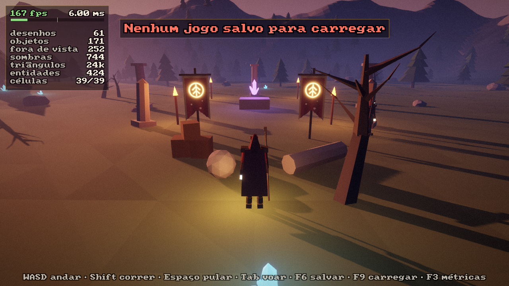

```rust
let ui = &mut ctx.ui;
// Texto: o `anchor` diz qual ponto da caixa do texto fica na posição dada.
let topo = ui.at(Anchor::Top, Vec2::new(0.0, 40.0));
ui.text(topo, "O santuário desperta", &TextStyle::new(24.0).anchor(Anchor::Top).color(dourado));

// Barra de vida no canto inferior esquerdo.
let barra = Rect::anchored(ui.at(Anchor::BottomLeft, Vec2::new(16.0, -16.0)), Vec2::new(200.0, 12.0), Anchor::BottomLeft);
ui.bar(barra, vida / vida_max, vermelho, Vec4::new(0.0, 0.0, 0.0, 0.6));

// Painel com borda atrás de um texto que quebra linha.
let estilo = TextStyle::new(16.0).wrap(320.0);
let caixa = Rect::new(Vec2::new(20.0, 20.0), ui.measure(dialogo, &estilo)).expand(10.0);
ui.panel(caixa, Vec4::new(0.05, 0.04, 0.06, 0.8), Vec4::new(0.55, 0.43, 0.28, 1.0));
ui.text(Vec2::new(20.0, 20.0), dialogo, &estilo);
```

- **Coordenadas:** pixels lógicos a partir do canto superior esquerdo da janela (`ui.size()`). Em telas de alta densidade o motor multiplica por `ui.scale()`.
- **Cores:** sRGB 0..1 com alfa.
- **Fonte:** bitmap 8x8 embutida, proporcional, com ASCII e Latin-1, então acentos e `ç` funcionam. Caracteres fora disso aparecem como `?`.
  - Tamanhos múltiplos de 8 ficam mais nítidos, mas qualquer tamanho fica com pixels limpos.
  - Cada glifo tem contorno de um pixel (`TextStyle::outline`; alfa 0 desliga), que mantém o texto legível sobre a cena escura.
- **Layout:**
  - `\n` quebra linha.
  - `TextStyle::wrap(largura)` quebra nos espaços.
  - `ui.measure` dá o tamanho antes de desenhar.
  - O mesmo `anchor` alinha as linhas à esquerda, ao centro ou à direita.
- **Sandbox:**
  - Dica de controles embaixo.
  - Avisos de save/load no topo.
  - Painel de métricas no F3 (quadro, desenhos, entidades, células).
  - Código em [hud.rs](examples/sandbox/src/hud.rs).

### Gatilhos e objetos usáveis

O motor diz o que está acontecendo; quem decide o que cada coisa faz é o jogo. Os dois são dados da cena (também nos arquivos de região):

```ron
triggers: [
    (name: "circle", shape: Cylinder(radius: 9.5, height: 6.0)),
    (name: "omen", shape: Ball(radius: 4.0), position: (10.0, 0.0, 3.0), once: true),
],
objects: [
    (name: "chest", mesh: Cube, position: (2.0, 0.0, 1.0), interact: (prompt: "abrir", radius: 2.5)),
],
```

```rust
let centro = jogador.body.center();

// Gatilhos: chame uma vez por quadro, com a posição do jogador.
for evento in ctx.world.update_triggers(centro) {
    match evento {
        TriggerEvent::Enter(nome) if nome == "circle" => { /* mostra o título, toca um som... */ }
        TriggerEvent::Exit(nome) => { /* ... */ }
        _ => {}
    }
}

// Objeto que o jogador pode usar agora, se houver.
if let Some(alvo) = ctx.world.interaction_target(centro, ctx.camera.forward(), &ctx.physics) {
    // Mostre `alvo.prompt` no HUD com `ctx.ui`.
    if ctx.input.just_pressed(KeyCode::KeyE) && alvo.name.as_deref() == Some("chest") {
        // Abriu: sem o componente, deixa de ser alvo (e o save lembra disso).
        ctx.world.ecs.remove_one::<Interactable>(alvo.entity).ok();
    }
}
```

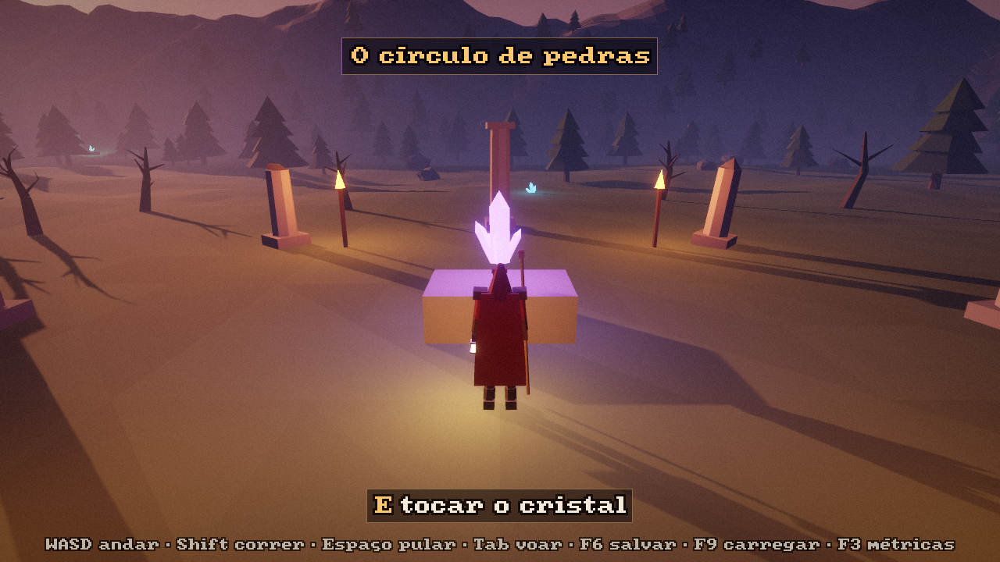

**Gatilhos**

- **Formas:** `Ball(radius)` e `Box(half_extents)` centradas na posição, `Cylinder(radius, height)` em pé sobre ela. `rotation` gira as caixas. Em cenas com terreno, `y` é medido a partir do chão (`snap_to_ground: false` desliga).
- **Eventos:** `Enter` e `Exit` chegam uma vez a cada mudança, com as saídas primeiro. Gatilhos com o mesmo nome contam como uma área só, o que serve para formas compostas.
- **`once: true`:** dispara só na primeira vez e não tem `Exit`. Continua gasto mesmo se a região descarregar ou um save for carregado. Tire o nome de `world.trigger_state.fired` para rearmar.
- **Em uma entidade:** `ecs.insert_one(goblin, Trigger::new("aura", TriggerShape::Ball { radius: 3.0 }))`. A área segue o `Transform` da entidade, sem a escala.
- **Quem ativa:** o motor testa o ponto que o jogo passa, um por vez. Gatilhos não têm colisão nem aparecem em `World::find`.

**Objetos usáveis**

- **Quem é o alvo:** o objeto precisa estar a até `radius` metros (padrão 2,5) da sua origem, visível e sem nada sólido no caminho. Vence o mais próximo, e o que está na direção de `forward` conta como mais perto: um objeto bem atrás vale o dobro da distância de um bem à frente.
- **Desligar:** remova o componente `Interactable`, ou esconda o objeto com `visible = false`.
- **No código:** `ecs.insert_one(entidade, Interactable::new("falar"))` torna usável uma entidade criada pelo jogo.

**Save e recarga**

- O save guarda em quais áreas o jogador está, os `once` gastos e quais objetos de `objects` perderam o `Interactable`. Um prompt trocado pelo jogo fica no estado do jogo.
- Como os outros objetos de streaming, os de uma região voltam como a cena descreve quando a região recarrega, e o `Interactable` removido volta junto.
- A recarga da cena (hot-reload ou F5) recria tudo: gatilhos disparam de novo.

No sandbox, entrar no círculo de pedras mostra o nome do lugar, o santuário só avisa uma vez e **E** apaga e acende o cristal do altar. O F3 mostra a área atual.

### Partículas

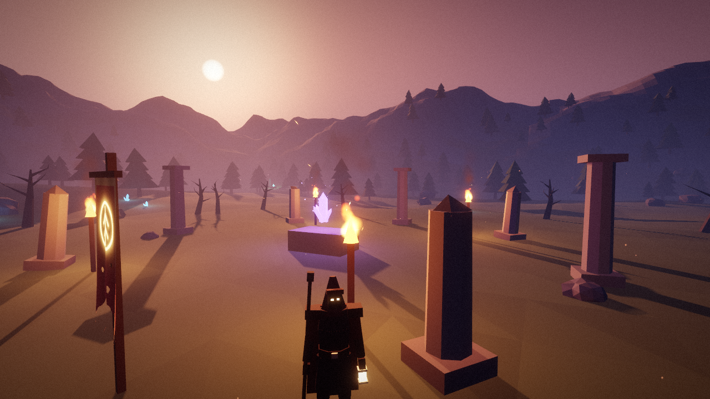

Um efeito é um arquivo `.ron` com uma lista de emissores que tocam juntos. Todos os campos são opcionais ([`ParticleDesc`](crates/grimora_core/src/particles.rs) lista cada um):

```ron
// assets/effects/brasa.ron
[
    (
        rate: 20.0,                  // por segundo; `burst` solta de uma vez
        lifetime: (0.5, 1.2),        // (mínimo, máximo) em segundos
        area: (0.1, 0.0, 0.1),       // meias-medidas da caixa de onde nascem
        direction: (0.0, 1.0, 0.0),
        spread: 20.0,                // graus em torno de `direction` (180 = todas)
        speed: (0.5, 1.5),
        acceleration: (0.0, -1.0, 0.0),
        drag: 0.5,
        turbulence: 2.0,
        sizes: [0.1, 0.0],           // chaves ao longo da vida
        colors: [(1.0, 0.7, 0.3, 1.0), (1.0, 0.2, 0.1, 0.0)], // sRGB com opacidade
        emissive: 5.0,               // brilho próprio, que alimenta o bloom
        additive: 1.0,               // 0 = cobre o fundo, 1 = soma luz
        lit: 0.0,                    // quanto recebe a luz da cena (fumaça, poeira)
        stretch: 0.02,               // estica na direção do movimento (fagulhas)
        shape: Diamond,              // Soft (padrão) ou Diamond
    ),
]
```

A cena põe o efeito num objeto, ou solto. Regiões e `scatter` aceitam igual:

```ron
objects: [
    (mesh: Cone(segments: 5), position: (4.5, 1.7, 6.0),
     // `position` gira com o objeto; `scale` multiplica tamanhos, velocidades e distâncias.
     effect: (path: "../effects/torch.ron", position: (0.0, 0.2, 0.0), scale: 1.0)),
],
effects: [
    (path: "../effects/dust.ron", position: (0.0, 1.8, 2.0)), // `y` a partir do chão
],
```

No código, `ParticleSystem` é um componente como outro qualquer:

```rust
// Uma vez só: a entidade some sozinha quando o efeito acaba.
let faisca = load_effect("assets/effects/faisca.ron")?;
ctx.world.play_effect(&faisca, posicao);

// Num inimigo, seguindo-o até o jogo tirar o componente ou a entidade.
ctx.world.ecs.insert_one(inimigo, ParticleSystem::new(aura, Vec3::Y, 1.0, 7))?;

// Liga e desliga sem cortar o que já está no ar.
ctx.world.ecs.get::<&mut ParticleSystem>(inimigo)?.emitting = false;
```

- **Mundo:** as partículas ficam onde nasceram: mover o objeto deixa um rastro, em vez de arrastar a chama inteira. Objeto com `visible: false` para de emitir.
- **Laços:** efeitos sem `duration` já começam no meio do ciclo, com a tocha acesa desde o primeiro quadro. A semente vem da posição: tochas iguais não dançam juntas, e o mesmo lugar sempre começa igual.
- **Ordem:** um único passe desenha tudo, do mais longe para o mais perto, então chama e fumaça se misturam na ordem certa.
- **Luz e névoa:** `lit` usa o ambiente, o sol e as luzes pontuais, sem sombra. A névoa apaga a luz somada e tinge o que cobre o fundo. Colada na câmera, a partícula some em vez de encher a tela.
- **Desempenho:** além de `max_distance` (padrão 60 m) o emissor dorme e não custa nada. Numa RTX 3060 em 1280x720 (`--release`), as ~340 partículas do sandbox custam 0,02 ms por quadro e 19,5 mil custam 2,1 ms.
- **Fora de escopo por enquanto:** a partícula corta seco ao encostar na geometria (sem *soft particles*), não colide com o chão e não faz nem recebe sombra. Elas também não entram no save: voltam a queimar sozinhas.
- **Hot-reload:** editar só o efeito não recarrega a cena. Salve o `.ron` da cena (ou aperte F5).

No sandbox, as tochas têm chama, fumaça e fagulhas, há poeira no ar, e **E** faz o cristal do altar estourar em faíscas ao despertar. O F3 mostra quantas partículas estão ativas.

### Personagens (NPCs)

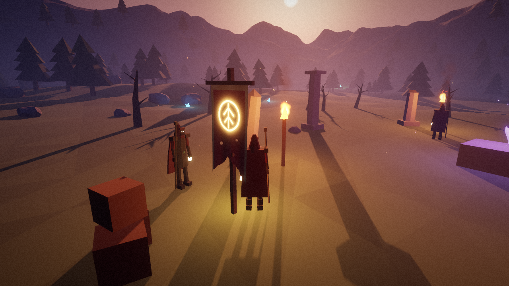

`npc:` faz um objeto andar sozinho. Não há malha de navegação para preparar: o caminho é procurado na física como ela está agora, então objetos de streaming e caixas empurradas já contam.

```ron
(name: "peregrino", mesh: Model(path: "../models/wanderer/wanderer.gltf"), position: (3.5, 0.0, 3.5),
 animation: "idle",
 npc: (
     walk_speed: 2.6,            // metros por segundo; também há run_speed, radius e height
     clip_speeds: (4.5, 8.5),    // velocidades para as quais `walk` e `run` foram feitos

     // O que faz sem nada chamar sua atenção:
     // Stand (padrão), Wander(radius: 5.0, pause: (2.0, 5.0)) ou:
     behavior: Patrol(points: [(-3.5, 0.0, -3.5), (3.5, 0.0, -3.5)], pause: 2.0), // `y` a partir do chão

     // Quando vê o jogador, com linha de visão livre: Watch, Follow(distance: 2.5) ou Flee.
     notice: (radius: 6.0, reaction: Watch),
 )),
```

O jogo chama uma vez por quadro, depois de mover o jogador:

```rust
for event in ctx.world.update_npcs(&mut ctx.physics, jogador.body.center(), dt) {
    if let NpcEvent::Noticed(npc) = event { /* NpcEvent::Lost(npc) quando perde o interesse */ }
}
```

Para dar as ordens no código, tire o `Brain` e use o `Agent`:

```rust
ctx.world.ecs.remove_one::<Brain>(guarda)?;
let agente = ctx.world.get_mut::<Agent>(guarda).unwrap();
agente.running = true;
agente.go_to(destino);          // pode chamar a cada quadro com um alvo em movimento
if agente.status() == AgentStatus::Arrived { /* também há Moving, Failed e Idle */ }
agente.look_at(ponto);          // vira para o ponto quando parado
agente.animate = false;         // o jogo escolhe os clipes (um ataque, por exemplo)
```

`Physics::find_path(de, para, &NavShape::new(raio, altura))` também pode ser usada sozinha.

- **Caminhos:** uma busca A* numa grade de 0,5 m, feita na hora com raios e testes de cápsula. Respeita degraus de até 0,4 m e rampas de até 40°, não desce de beiradas e desvia de corpos dinâmicos. Um destino dentro de algo sólido vira o chão ao lado; sem caminho, o personagem chega o mais perto que der e fica em `Failed`.
- **Encontros:** personagens desviam uns dos outros e do jogador, cada um pela própria direita. A cápsula deles bloqueia o jogador e aparece em `Physics::raycast`, mas não em buscas de caminho nem em `Physics::raycast_scenery`, usada pela câmera.
- **Animação:** o motor toca `idle`, `walk` e `run` conforme a velocidade, sem deixar os pés deslizarem.
- **Streaming e saves:** num arquivo de região, o personagem carrega e descarrega junto com ela e volta ao ponto inicial. O save guarda só onde ele está: ao carregar, ele retoma a rotina do começo.
- **Desempenho:** no sandbox, a busca mais cara medida (destino inalcançável) custou 1,2 ms, e o motor faz no máximo 2 por quadro. Numa RTX 3060 em 1280x720 (`--release`), cada personagem custa cerca de 17 µs por quadro: 100 passeando somam 1,7 ms. A mais de 120 m do jogador, ele espera parado e não custa nada.
- **Fora de escopo por enquanto:** a grade tem um andar só por célula, então um caminho não escolhe entre uma ponte e o que passa embaixo dela. Personagens não pulam. Multidões apertadas podem travar um pouco antes de achar outra rota.

No sandbox, o vigia observa e responde com **E**, o peregrino dá voltas em torno do altar, um segue o jogador e outro foge.

### Eventos de animação e combate

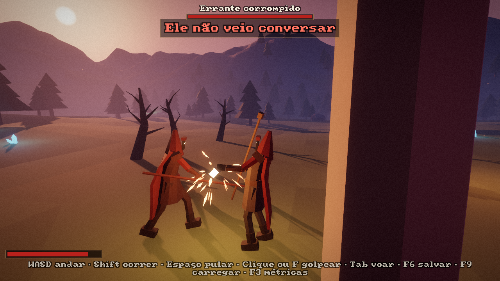

Um **evento** marca um instante de um clipe: um pé no chão, um golpe que acerta. Eles vêm do glTF, em `extras` da animação, ou do arquivo de cena, para um modelo que não os tem:

```ron
// No .gltf: "animations": [{ "name": "attack", "extras": { "events": [{ "time": 0.38, "name": "hit" }] }, ... }]
mesh: Model(path: "orc.glb", events: [("attack", 0.38, "hit"), ("walk", 0.2, "step")]), // clipe, segundos, nome
```

```rust
for evento in animator.events() { /* os que passaram na última atualização */ }
if animator.fired("step") { /* tocar um passo */ }
animator.replay_once("attack", 0.08); // do começo, mesmo que já esteja tocando
```

Em laço, cada evento dispara uma vez por volta, e a velocidade do clipe conta. Um clipe saindo num crossfade não dispara nada, nem um tocado de trás para frente. O andarilho do sandbox tem `step` em `walk` e `run`, `swing` e `hit` em `attack` e `fall` em `die`.

**Combate:** `combat:` deixa um objeto ser ferido e, com `weapon`, revidar. O dano acontece no quadro em que o clipe dispara o evento da arma, então ele combina com o que aparece na tela.

```ron
(name: "guarda", mesh: Model(path: "../models/wanderer/wanderer.gltf"), animation: "idle",
 npc: (notice: (radius: 9.0, reaction: Attack)),   // persegue o jogador e golpeia ao alcançar
 combat: (
     health: 30.0,
     team: 1,                 // golpes só acertam outros times; o jogador costuma ser o 0
     radius: 0.4,             // largura do alvo: o golpe alcança isso a mais
     weapon: (damage: 8.0, reach: 1.7, arc: 90.0, cooldown: 2.0, clip: "attack", event: "hit"),
 )),
(name: "barril", mesh: Cube, combat: (health: 15.0)), // sem clipe `die`: some ao quebrar
```

O jogo chama uma vez por quadro, depois de `update_npcs`, e dá vida e arma ao seu jogador:

```rust
ctx.world.ecs.insert(avatar, (Health::new(60.0, 0), Fighter::new(Weapon { damage: 10.0, ..Default::default() })))?;

if clicou { ctx.world.get_mut::<Fighter>(avatar).unwrap().attack(); }
jogador.locked = lutador.busy() || vida.staggered() || vida.is_dead(); // trava WASD e pulo; a câmera continua

for evento in ctx.world.update_combat(&mut ctx.physics, dt) {
    if let CombatEvent::Hit { attacker, target, damage, position, direction, killed } = evento { /* som, faíscas... */ }
}
ctx.world.damage(alvo, 5.0, &mut ctx.physics);  // armadilhas e magias
ctx.world.npcs_ignore_player = true;            // ninguém persegue quem morreu (ou numa cena de diálogo)
ctx.world.revive(avatar, &mut ctx.physics);     // de pé outra vez; a animação fica com o jogo
```

- **Quem é atingido:** quem tem `Health` de outro time, dentro de `reach` e de `arc` graus à frente, até 2 m acima ou abaixo, sem nada sólido no caminho. Um personagem sem `Health` não pode ser ferido: no sandbox, só o errante corrompido e o barril podem.
- **Reações:** o alvo toca `hurt`, fica sem agir por 0,35 s, perde o golpe que ainda não acertou e, se tiver `Brain`, percebe quem o atacou. Em zero, toca `die` e fica caído, sem cápsula para atrapalhar a passagem.
- **Clipes que faltam:** sem o clipe da arma, o golpe acerta na hora. Sem o evento, acerta no fim do clipe. Sem `hurt`, o alvo não vacila.
- **Pausa:** com o mundo pausado, as animações param e os eventos ficam guardados. O jogo não chama `update_combat`, e o golpe em andamento acerta depois, no momento certo. É assim que o sandbox faz: o menu de pausa volta antes de qualquer lógica do jogo.
- **Saves:** a vida de cada objeto da cena entra no save, e quem morreu continua caído ao carregar. Um personagem de região volta inteiro quando ela recarrega.
- **Desempenho:** no sandbox, com o errante corrompido em cena, um quadro custa 0,95 ms numa RTX 3060 em 1280x720 (`--release`). Quase nada disso é do combate, que só percorre quem tem arma e procura alvos no quadro do golpe. No pior caso testado, 100 inimigos perseguindo e golpeando o jogador ao mesmo tempo, a média foi de 5,9 ms e o percentil 95 de 13 ms, a maior parte em busca de caminhos.
- **Fora de escopo por enquanto:** `Brain` só persegue o jogador; para um personagem atacar outro, o jogo dá as ordens pelo `Agent` e pelo `Fighter`. Não há bloqueio, armas à distância nem camadas de animação: o corpo inteiro para durante o golpe.

**Espada:** com `blade`, o golpe deixa de olhar `reach` e `arc` (que só dizem quando um NPC deve golpear) e fere o que a lâmina toca de verdade, uma vez por golpe, entre os eventos `hit_on` e `hit_off` do clipe.

```ron
weapon: (damage: 10.0, cooldown: 0.0,
         clip: "sword_1", combo: ["sword_2", "sword_3"], // o próximo começa no evento `combo`
         blade: (),       // osso `weapon.R`; `joint`, `base`, `tip` e `radius` mudam isso
         stamina: 16.0,   // custo; sem `Stamina` na entidade, nada é cobrado
         hit_stop: 0.075) // os dois lados quase param por esse tempo ao acertar
```

- **Combo:** `Fighter::attack` pedido no meio de um golpe fica guardado por 0,45 s, e por isso um clique adiantado não se perde. O evento `cancel` marca onde a recuperação pode ser cortada (`can_cancel`, `interrupt`), como numa rolagem.
- **Movimento vindo do clipe:** o osso `root` do clipe não mexe na pose. `Animator::root_delta` diz quanto ele andou neste quadro, e quem move a cápsula é o `ThirdPersonController::root_motion` (ou o `Agent`, sozinho).
- **Esquiva:** `Health::make_untouchable(segundos)` faz `damage` devolver `None` nesse tempo. O sandbox rola com direção, ou dá um passo para trás sem ela, e cobra `Stamina`.
- **Travar a câmera:** `World::find_lock_target` e `next_lock_target` só escolhem alvos à vista; `ThirdPersonController::lock_target` leva a câmera e `lock_holds` diz quando soltar. Segurar a trava é do jogo.
- **Na mão:** `World::attach(pai, "osso", malha, deslocamento)` prende uma malha a um osso, e ela sai junto com o pai.
- **Câmera lenta:** `Time::set_scale` escala o relógio do mundo, para conferir um golpe quadro a quadro. No sandbox é o F4.

Os golpes agora se editam no [animador](#animador). Eles nasceram em texto, em `tools/blender/sword_moves.py`, e `blender --background --python tools/blender/build_wanderer.py -- --export-clips` os exporta de novo para `wanderer_clips/`, **por cima do que foi salvo no animador**. Em `sword_moves.py`: poses-chave por controle (mãos, pés, quadril, tronco, cabeça, lâmina), resolvidas por IK em `anim_kit.py`. O corpo não fica preso às chaves: molas o fazem chegar um pouco depois, passar do ponto e assentar. O `sword_moves.py` é o conjunto da espada leve, que toda espada leve usa: corte descendo, corte de volta subindo pela mesma linha e estocada longa, todos com uma mão.

```bash
blender --background --python tools/blender/build_wanderer.py -- --metrics sword_1
```

Isso imprime em 2 segundos, sem gravar nada, uma linha `[anim]` por clipe, com pé que não alcança ou escorrega, salto de rotação por quadro, pulso, torção do antebraço e velocidade da ponta da lâmina, além da linha do tempo do clipe nomeado. Sem `--metrics`, o comando remonta o modelo. Com `-- --strips <pasta> sword_1 sword_2`, ele também desenha uma folha de 8 quadros de cada clipe, e com `-- --closeup <pasta> sword_idle` mostra a mão no cabo.

No sandbox, **clique** ou **F** golpeia na direção da câmera. O errante corrompido, a oeste do círculo, ataca quem chega perto. Ao morrer, o jogador volta ao início com a vida cheia depois de 4 s.

### Animador

Uma ferramenta dentro do motor para fazer golpes arrastando o personagem:

```bash
cargo run --release -p animator
```

Abra um clipe na lista da esquerda, pare no quadro que quiser e arraste as alças: mãos, pés, quadril, ponta da espada, cotovelos e joelhos seguem por IK, e tronco e cabeça giram. Mexer em qualquer momento cria uma chave ali. Salve com Ctrl+S: os clipes são os arquivos de texto em `assets/models/wanderer/wanderer_clips/`, e o jogo os lê ao abrir.

| Entrada | Ação |
| --- | --- |
| Botão esquerdo numa alça | Move a parte (Shift: gira; na ponta da espada, gira o fio) |
| Botão direito / meio / roda | Orbita / move / aproxima a câmera |
| Espaço | Toca ou pausa, em 100%, 50%, 25% ou 10% |
| Setas | Quadro a quadro |
| Linha do tempo | Clique para ir ao momento, arraste chaves e marcas; na linha "Tudo", move a pose inteira |
| K / Delete | Põe uma chave aqui / apaga a chave ou a marca selecionada |
| Ctrl+Z / Ctrl+Y / Ctrl+S | Desfaz / refaz / salva tudo |

- **Parada, a tela mostra as chaves exatas; tocando, o corpo segue as chaves com molas**, que dão o peso. "Ver molas parado" mostra as molas quadro a quadro.
- **"Alcance"** é até onde, em segundos, um arraste leva junto as chaves vizinhas, para dobrar um arco em vez de amassá-lo. Com 0, só a chave daquele momento muda.
- **Marcas:** a faixa vermelha é onde a lâmina fere (`hit_on` a `hit_off`), `combo` é onde o próximo golpe pode entrar e `cancel`, onde a rolagem pode cortar a recuperação. Tocando, a lâmina é testada contra o alvo, com pausa de impacto e rastro, e a tela diz em que momento acertou ou por quantos centímetros errou.
- **Pulso, Giro e Falta** ficam vermelhos quando a pose força o braço (pulso acima de 65°, giro acima de 100°) ou quando o membro não alcança o ponto pedido.
- Para renomear ou apagar um clipe, renomeie ou apague o arquivo. Os clipes de "Só ver" vêm do glTF e não têm poses para editar.

### Menus e estados de jogo

O motor oferece as peças; cada jogo decide quais telas tem. O sandbox abre numa tela de título sobre a cena viva, pausa no **Esc** e guarda as opções num arquivo ([menu.rs](examples/sandbox/src/menu.rs)).

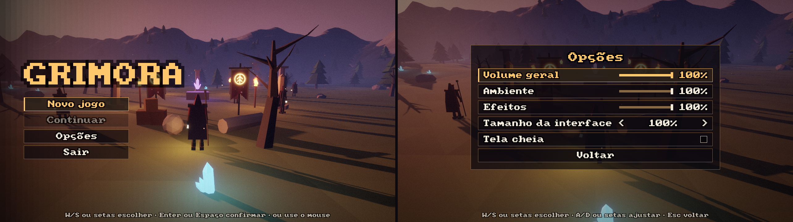

**Widgets.** Botão, controle deslizante, liga/desliga e lista de escolha em modo imediato, no mesmo `ctx.ui` do HUD e no mesmo estilo de pixels:

```rust
let ui = &mut ctx.ui;
let linha = |n: f32| Rect::new(Vec2::new(40.0, 100.0 + n * 52.0), Vec2::new(600.0, 44.0));
if ui.button(linha(0.0), "Novo jogo") {
    // clicado, ou Enter/Espaço com o foco nele
}
if ui.button_if(tem_save, linha(1.0), "Continuar") { /* cinza e inerte sem save */ }
if ui.slider(linha(2.0), "Volume", &mut volume, 0.0..=1.0, 0.05) {
    ctx.audio.set_master_volume(volume); // true nos quadros em que o valor muda
}
ui.toggle(linha(3.0), "Tela cheia", &mut cheia);
ui.choice(linha(4.0), "Dificuldade", &["Fácil", "Difícil"], &mut dificuldade);
```

- **Foco:** um widget por vez tem o foco; o primeiro habilitado começa com ele. Setas ou W/S movem o foco (pulando os desabilitados e dando a volta), e o mouse o toma ao passar por cima. Um cursor parado não briga com o teclado.
- **Teclado:** Enter ou Espaço usam o widget em foco; esquerda/direita ou A/D mudam deslizantes, liga/desliga e listas. Segurar uma direção repete.
- **Mouse:** um clique pede apertar e soltar no mesmo widget. O deslizante segue o cursor, mesmo fora dele, enquanto o botão estiver apertado na trilha.
- **Trocar de tela:** chame `ui.reset_focus()` (o primeiro widget toma o foco) ou `ui.set_focus("Opções")` (para voltar de onde veio). O widget é identificado pelo rótulo, então dois na mesma tela não devem ter o mesmo.
- **Aparência:** `ui.theme` guarda cores e tamanho do texto. Os estados são normal, sob o cursor, em foco, apertado e desabilitado.
- **Entrada:** o motor preenche `UiInput` a partir de `ctx.input` a cada quadro, já em pixels lógicos. Com o cursor preso (`set_cursor_grab(true)`), o mouse não alcança os widgets.

**Pausa.** `ctx.set_paused(true)` para o mundo: o motor pula física, animações e partículas, e o `Game::update` continua rodando para desenhar os menus. Pule a sua própria simulação nesse quadro.

- `ctx.time.delta()` e `elapsed()` são tempo real e nunca param: use-os em menus e em avisos que somem.
- `ctx.time.world_delta()` e `world_elapsed()` param na pausa e seguem de onde estavam: use-os no que pertence ao mundo. O tremor das luzes também usa esse relógio.
- O som continua tocando na pausa; quem quiser silêncio baixa o volume.

**Outras peças do `Context`:**

| Peça | Efeito |
| --- | --- |
| `EngineConfig { escape_quits: false, .. }` | O **Esc** deixa de fechar o motor e fica para o jogo (o padrão continua fechando) |
| `ctx.set_cursor_grab(false)` | Solta o cursor enquanto um menu está aberto; o jogo o prende de novo ao voltar |
| `ctx.set_ui_scale(1.5)` | Aumenta toda a interface; `ui.size()` encolhe junto, então os layouts se ajustam |
| `ctx.set_fullscreen(true)` | Janela sem bordas em tela cheia |
| `ctx.reload_scene()` | Reconstrói o mundo a partir do arquivo no próximo quadro (`Game::scene_loaded` roda de novo) |

**Sandbox:**

- **Título:** Novo jogo, Continuar (só com save; carrega o mais recente), Opções, Sair. O andarilho fica parado com a lanterna e os outros personagens seguem suas rotinas.
- **Pausa:** Continuar, Salvar (no mesmo slot do F6), Carregar, Opções, Menu principal, Sair. **Esc** fecha.
- **Opções:** volume geral, ambiente e efeitos (`Category`), tamanho da interface e tela cheia. Valem na hora e são gravadas de forma atômica ao sair da tela, em `<saves>/config/options.ron`. Um arquivo quebrado é ignorado com um aviso no terminal.

**Automação.** `--screenshot`, `--frames`, `--load`, `--camera`, `--look-at` e `--no-ui` continuam indo direto para o jogo. `--screenshot` e `--frames` também ignoram as opções salvas e não gravam nada, para a captura não depender da máquina. Para capturar um menu, use `--menu`:

```bash
cargo run -p sandbox -- --screenshot screenshots/menu_title.png --size 1280x720 --menu title
cargo run -p sandbox -- --screenshot screenshots/menu_pause.png --size 1280x720 --menu pause
cargo run -p sandbox -- --screenshot screenshots/menu_options.png --size 1280x720 --menu options
cargo run -p sandbox -- --screenshot screenshots/menu_video.png --size 1280x720 --menu video
cargo run -p sandbox -- --screenshot screenshots/menu_controls.png --size 1280x720 --menu controls
```

`pause` e `options` jogam 30 quadros antes de abrir, para mostrar um jogo em andamento. Testes sem janela usam `Context::headless` e `headless_frame`, que rodam os mesmos passos do laço principal, sem renderizar ([tests/pause.rs](crates/grimora/tests/pause.rs)).

- **Fora de escopo por enquanto:** sem confirmação ao sair para o menu principal, sem rolagem nem campos de texto, e o menu não reage à perda de foco da janela.

### Controles e opções

O jogo pergunta por **ações com nome**, não por teclas. Cada ação guarda uma lista de controles (tecla, botão do mouse, botão do gamepad ou direção de um analógico), e o motor já traz as de andar, correr, pular, usar, golpear, rolar, travar alvo e pausar em `grimora::core::actions`:

```rust
ctx.input.actions.add("magia", [Binding::Key(KeyCode::KeyG), Binding::Pad(PadButton::North)]); // a sua, com o padrão dela
if ctx.input.action_just_pressed(actions::JUMP) { /* ... */ }
let frente = ctx.input.action_axis(actions::MOVE_BACK, actions::MOVE_FORWARD); // analógico, de -1 a 1
ctx.input.actions.rebind("magia", Binding::Key(KeyCode::KeyR)); // troca; se a tecla já tiver dono, os dois trocam de lugar
```

| Ação | Teclado e mouse | Gamepad |
| --- | --- | --- |
| Andar | WASD | analógico esquerdo |
| Olhar | mouse | analógico direito |
| Correr | Shift | LB |
| Pular | Espaço | A |
| Usar | E | X |
| Golpear | clique ou F | RT |
| Rolar | Ctrl esquerdo | B |
| Travar alvo | Q | RB |
| Pausar | Esc | Start |

No menu, as setas do gamepad movem o foco, A confirma e B volta. **Esc, F3, F5, F12 e Start** são reservados e não podem ser reatribuídos.

`Options` guarda o que o jogador muda (volumes, interface, tela cheia, resolução, vsync, sombras, antisserrilhado, sensibilidade, inversão do eixo Y e controles) em `<saves>/config/options.ron`. `Options::load` lê, `apply(ctx)` aplica e `apply_at_startup(&mut config)` cobre o que precisa valer antes da janela abrir. O antisserrilhado só muda ao reiniciar. O sandbox tem as telas **Vídeo** e **Controles**:

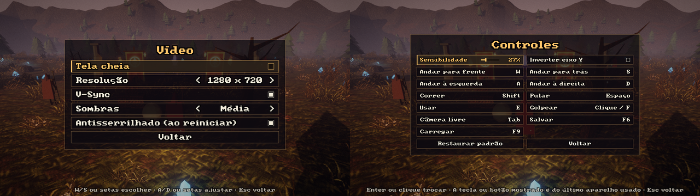

### Texturas e sprites

`assets/textures/` traz a biblioteca do motor, em pixel art de 128x128: pisos, paredes, rochas, madeiras, tecidos, plantas, teias, decalques, sol e luas. Para trazer imagens novas:

```bash
python -I tools/import_textures.py "C:/caminho/da/pasta"
```

Ele copia os PNG da pasta e de `moons/` com nomes em ASCII minúsculo (`água.png` vira `agua.png`) e prepara a borda dos sprites transparentes. Uma imagem `<nome>_emission.png` ao lado de `<nome>.png` faz o desenho brilhar sozinho, a qualquer hora, sem nada a declarar na cena.

```ron
// Uma imagem sobre a malha inteira; `tile` são os metros de cada repetição, seja qual for o tamanho do objeto.
(mesh: Cube, scale: (2.4, 0.8, 1.5), texture: (path: "../textures/pedra_inscricoes_gastas.png", tile: 1.6)),
// Planta: imagens cruzadas em pé, com a base no chão. `size` é a altura do desenho, sem contar as margens vazias.
(mesh: Sprite(texture: "../textures/samambaia.png", size: 1.0), position: (3.0, 0.0, 2.0)),
// Imagem parada: um plano só e sem vento (uma cerca, uma teia, um pano).
(mesh: Sprite(texture: "../textures/cerca_quebrada.png", size: 1.3, planes: 1, sway: 0.0)),
// Decalque: imagem deitada no chão, sem sombra nem colisor. Gire o objeto para pô-la numa parede.
(mesh: Decal(texture: "../textures/decal_sangue_gotas.png", size: 1.5), position: (2.0, 0.05, 0.0)),
```

`scatter` também aceita `texture`, `Sprite` e `Decal` (use `sink: 0.0` nos decalques). O terreno troca as cores por imagens, escolhidas pela mesma inclinação e altura das cores:

```ron
terrain: (textures: (grass: "../textures/grama1.png", dirt: "../textures/terra_pedregosa.png",
                     rock: "../textures/rocha_umida_escura.png", tile: 4.0)),
```

Imagem ausente só registra o erro: a cena abre com a malha sem textura (um cubo magenta no lugar de um sprite ou decalque).

Limites: sprites têm luz de cima, como o chão em volta, e não projetam sombra sem `shadow: true`. Decalques são planos, então em terreno inclinado parte deles afunda. A textura vai por projeção de caixa, com emendas em objetos redondos.

### Dia e noite

```ron
day_cycle: (time: 16.5, day_length: 480.0, sunrise: 40.0, tilt: 35.0),
```

`time` é a hora inicial, `day_length` os segundos reais de um dia inteiro (0 para o relógio), `sunrise` onde o sol nasce (em graus, 0 é +X e 90 é -Z) e `tilt` o quanto ele passa longe do topo ao meio-dia. O sol nasce às 6 e se põe às 18. O relógio assume sol, luz ambiente, cor e densidade da névoa, cores do céu, exposição e estrelas do `environment`; o resto continua valendo. Para outro clima, liste `keys`, um horário por entrada: o motor interpola entre eles, e sem `keys` vale um dia de céu pesado, com noites frias e auroras vermelhas.

```ron
environment: (sky: (sun_texture: "../textures/sol.png", moon_texture: "../textures/lua.png", sun_sprite_size: 6.0, moon_sprite_size: 5.0)),
```

A luz direcional é o sol de dia e a lua de noite, e as duas se apagam na troca para a sombra não saltar. O relógio para na pausa e entra no save. `--time <hora>` trava a hora, para capturas repetíveis. No código: `world.time_of_day()`, `world.set_time_of_day(hora)` e `world.is_night()`.

Uma luz com `night_only: true` acende ao anoitecer, como a da cabana do sandbox.

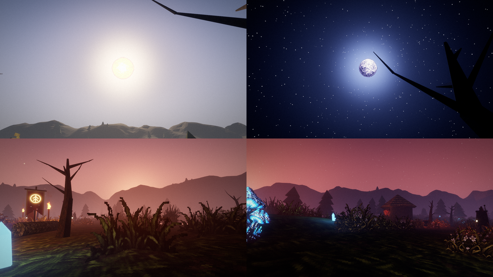

Limites: o céu mostra uma lua só. Sem nuvens nem clima. A luz direcional não desce abaixo de cerca de 8 graus, para as sombras não cruzarem o mapa, então o sol no horizonte ilumina um pouco mais alto do que aparece.

### Água, vento e transparência

```ron
environment: (wind: (direction: (1.0, 0.35), strength: 1.0, speed: 1.6)),
terrain: (ponds: [(x: 20.0, z: 13.0, radius: 8.0, depth: 1.7)]),
water: [(position: (20.0, 1.3, 13.0), size: (20.0, 20.0), texture: "../textures/agua.png",
         color: (0.75, 0.9, 1.0), opacity: 0.72, tile: 3.5, waves: 0.04)],
```

`ponds` cava o terreno, e nada do `scatter` nasce dentro. O `y` da água conta a partir do chão em `position`, que aqui é o fundo da lagoa. As ondas movem os vértices e o sombreamento facetado vem das faces delas; duas camadas da imagem derivam com o vento, e olhando de lado a água reflete o céu. O vento balança tudo que tem `sway`, com rajadas que atravessam o campo.

`AlphaMode::Blend` agora é transparência de verdade: desenhada depois do que é opaco, do objeto mais longe para o mais perto. Dentro de um mesmo objeto nada é ordenado, então prefira formas simples.

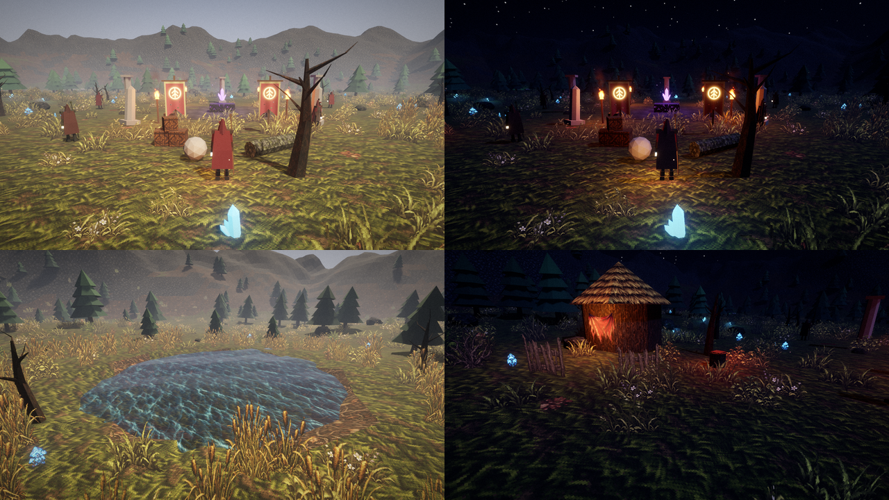

Limites: a água não tem colisor, então personagens andam pelo fundo, sem nado nem física de flutuação. Não há reflexo dos objetos, só do céu, nem refração. Partículas atrás da água aparecem na frente dela, porque a água não grava profundidade.

### Áudio

Sons em loop fazem parte da cena. Sem `position`, o som é ambiente (igual em todo lugar); com `position`, ele vira um emissor 3D: volume cheio até `min_distance`, cai pela distância (-6 dB a cada vez que ela dobra) e some em `max_distance`, com o pan acompanhando a câmera. Com terreno, `y` é medido a partir do chão. Objetos também carregam um som, como carregam uma luz; aí `position` é um deslocamento a partir do objeto:

```ron
sounds: [
    (path: "../sounds/wind.ogg", volume: 0.35),
    (path: "../sounds/hum.wav", position: (0.0, 1.6, 0.0), volume: 0.4, min_distance: 2.0, max_distance: 14.0),
],
objects: [
    (mesh: Cone(segments: 5), position: (4.5, 1.7, 6.0), sound: (path: "../sounds/fire.ogg", position: (0.0, 0.3, 0.0))),
],
```

No jogo, use `ctx.audio` (volumes são ganhos lineares, 1 = como gravado):

```rust
ctx.audio.play("assets/sounds/step_1.wav", 0.5);                       // efeito único
ctx.audio.play_at("assets/sounds/fire.ogg", 1.0, Emitter::at(posicao)); // efeito único no mundo
let vento = ctx.audio.play_loop("assets/sounds/wind.ogg", 0.3);         // loop ambiente
let tocha = ctx.audio.play_loop_at("assets/sounds/fire.ogg", 0.8, Emitter::at(posicao));
if let Some(id) = tocha { ctx.audio.set_position(id, nova_posicao); }   // e ctx.audio.stop(id)
ctx.audio.set_volume(Category::Ambient, 0.5);                           // e set_master_volume
```

- Arquivos ficam em cache pelo caminho; se o arquivo mudar no disco, é lido de novo no próximo uso.
- A cada (re)carga da cena, os loops da cena são trocados: os que não mudaram continuam tocando sem reiniciar, os removidos somem com fade. Loops iniciados pelo jogo ficam até `stop(id)`.
- Sem dispositivo de áudio, o motor avisa no log e segue mudo. Capturas (`--screenshot`) carregam e mixam tudo, mas não tocam nada.
- Os sons do sandbox (vento, fogo, zumbido do cristal e passos) são sintetizados por [tools/gen_sounds.py](tools/gen_sounds.py) (Python puro, sementes fixas): `python -I tools/gen_sounds.py`.

### Mundos grandes: culling e LOD

O renderizador só desenha o que aparece: cada objeto é testado contra o campo de visão da câmera e, para a sombra, contra o volume coberto pelo sol (assim árvores atrás da câmera ainda projetam sombra na tela). Objetos menores que ~1,5 pixel são pulados (`RendererSettings::min_screen_size`).

Malhas podem ter versões mais simples para quando o objeto aparece pequeno na tela:

```rust
let arvore = pinheiro_detalhado.with_lods([(0.04, pinheiro_simples)]); // abaixo de 4% da altura da tela
```

Pinheiros, árvores mortas e rochas geradas já vêm com um LOD de mesmo contorno. A cena [bench_forest.ron](assets/scenes/bench_forest.ron) (23 mil objetos, 2 milhões de triângulos) serve de referência, numa RTX 3060 em 1280x720:

| | Antes | Culling | Culling + LOD |
|---|---|---|---|
| Visão do jogador | 4,1 ms | 2,9 ms | 2,3 ms |
| Visão aérea | 3,9 ms | 3,4 ms | 2,5 ms |

```bash
cargo run --release -p sandbox -- --scene assets/scenes/bench_forest.ron --no-vsync --frames 600 --screenshot screenshots/bench.png
```

### Sombras em cascata

A sombra do sol usa até 4 mapas de 2048², cada um cobrindo da câmera até uma distância maior (por padrão ~8, 18, 38 e 120 m). Perto do personagem um texel de sombra mede pouco mais de 1 cm; longe, ~14 cm. Nas emendas, uma cascata se mistura com a próxima, e a última some aos poucos no fim de `distance`.

```ron
shadows: (enabled: true, distance: 120.0, strength: 0.85, cascades: 4),
```

- Cada mapa envolve uma esfera, cujo tamanho não muda quando a câmera gira, e se move em passos de um texel: as bordas das sombras não tremem.
- Cada cascata desenha só os objetos dentro do seu volume (incluindo até 100 m na direção do sol, para árvores fora da tela que ainda fazem sombra), pula os menores que um texel e escolhe o LOD pelo tamanho do objeto no mapa.
- `shadow_casters` nas métricas conta um objeto uma vez por cascata em que aparece.


No `bench_forest.ron`, as 4 cascatas custam cerca de 0,5 ms a mais que o mapa único antigo, que chegava só a ~60 m e era bem mais borrado.

### Streaming: mundo em células e regiões

Com `streaming` na cena, só o que está perto da câmera existe de fato (desenhado, iluminado e sólido):

```ron
streaming: (cell_size: 32.0, load_distance: 150.0),
regions: [
    (path: "regions/shrine.ron", center: (-55.0, 0.0, -60.0), radius: 10.0),
],
```

- **Células:** os objetos do `scatter` são distribuídos numa grade de `cell_size` metros. As células a menos de `load_distance` da câmera entram no mundo (até 8 por quadro, as mais próximas primeiro) e saem um pouco mais longe do que entraram, para não piscarem na borda. Objetos de `objects` ficam sempre carregados.
- **Regiões:** pedaços da cena em arquivos `.ron` próprios ([regions/shrine.ron](assets/scenes/regions/shrine.ron) no sandbox), com `objects`, `scatter`, luzes, sons e gatilhos. Quando a câmera chega a `load_distance` do círculo (`center`, `radius`), o arquivo é lido e montado numa thread separada e entra no mundo sem travar o quadro; ao se afastar, sai com colisores, luzes e sons. As malhas de uma região voltam a ser usadas se ela carregar de novo. Um arquivo com erro aparece uma vez no log e é ignorado até a cena recarregar.
- **Terreno:** é cortado em blocos de 32×32 quadrados, cada um com seu colisor, para o culling descartar o que está fora da tela.
- **Luzes:** o renderizador usa as 32 luzes pontuais mais próximas da câmera, então um mundo grande pode ter quantas quiser.
- Deixe `load_distance` além do ponto em que a névoa apaga tudo (cerca de `4 / fog.density`), senão a borda do mundo carregado aparece em vistas aéreas.
- No código: as entidades carregadas entram e saem de `world.ecs` (uma entidade streamada que o jogo removeu volta quando a célula recarrega); `World::streaming_stats()` diz quanto está carregado; `World::load_around(ponto, physics)` carrega tudo de uma vez (útil em testes e teletransportes).

Em [bench_forest.ron](assets/scenes/bench_forest.ron) (`load_distance: 450`, mesma máquina da tabela acima), o quadro na visão do jogador cai de 2,3 ms para 1,35 ms (medido antes das sombras em cascata), com 188 de 315 células carregadas. A carga inicial das células leva ~2 ms.

### Salvamento de jogo

Cada save é um arquivo RON legível num slot (`quick.ron`, `slot_1.ron`...). O jogo decide o que guardar do próprio estado; o motor junta a câmera e os objetos da cena que mudaram:

```rust
#[derive(Serialize, Deserialize)]
struct MeuSave { jogador: CharacterState, ouro: u32 }

ctx.save_game("slot_1", &MeuSave { jogador: player.state(), ouro: self.ouro })?;

let save: MeuSave = ctx.load_game("slot_1")?;
player.restore(&save.jogador);
self.ouro = save.ouro;
```

- **O que o motor guarda sozinho:** a câmera, o estado dos gatilhos e cada objeto da cena (`objects` do `.ron`) que foi movido, escondido (`visible = false` no `Renderable`), removido (`World::despawn`), perdeu o `Interactable` ou ainda está rolando, com a velocidade dos corpos dinâmicos. Objetos que não mudaram ficam de fora, então o save é pequeno.
- **Ao carregar:** os objetos da cena voltam para onde o arquivo da cena os colocou (os removidos são recriados; os outros mantêm o mesmo `Entity`), as mudanças salvas são aplicadas por cima (caixas empurradas voltam com física e tudo), a câmera volta e o conteúdo de streaming é recarregado em volta dela.
- **Fica com o jogo:** entidades criadas pelo jogo (`World::spawn`), componentes do próprio jogo e o personagem (`ThirdPersonController::state()`/`restore()` dão um `CharacterState` pronto para salvar).
- **Segurança:**
  - A gravação é atômica: o arquivo novo só substitui o antigo depois de inteiro no disco.
  - Um save feito em outra cena é recusado sem mexer em nada.
  - Um objeto salvo cujo nome não bate mais com a cena (porque o `.ron` mudou) é pulado com aviso.
  - Campos novos no estado do jogo com `#[serde(default)]` mantêm saves antigos válidos.
- **Slots:** `ctx.saves` (`SaveStore`) lista os slots do mais recente ao mais antigo, apaga e lê/grava qualquer valor serializável (útil também para configurações).
- **Limitação:** objetos espalhados por streaming (`scatter` com `streaming`) não são salvos; voltam ao estado da cena quando a célula recarrega.

## Visão

O objetivo inicial é dar suporte a um jogo de mundo aberto com visual low poly dark fantasy estilizado, priorizando iluminação, atmosfera e identidade em vez de realismo.

Diretrizes:

- Motor próprio, sem Unreal, Godot, Unity ou Three.js como base; bibliotecas especializadas são bem-vindas.
- Sem editor visual como objetivo inicial: cenas e configurações vivem em arquivos de texto.
- Adequado ao desenvolvimento com IA: executar cenas, ler erros e métricas e capturar imagens pela linha de comando.
- Plataforma inicial: Windows para PC.
- Caminho aberto para mundo aberto 3D e para servir de base a outros jogos.

## Roteiro

**Feito (v0.1)**
- [x] Renderizador wgpu: HDR, MSAA 4x, sombra direcional com PCF e estabilização (4 cascatas), névoa de altura com dispersão do sol, céu procedural, até 32 luzes pontuais com cintilação, materiais emissivos, bloom, tonemapping ACES e gradação de cor
- [x] Cenas RON com hot-reload, terreno procedural e geradores de props low poly
- [x] Capturas, posicionamento de câmera e métricas por linha de comando
- [x] Colisão com Rapier: terreno, props e colisores declarados na cena
- [x] Personagem em terceira pessoa: andar, correr, pular, degraus e rampas; câmera orbital que não atravessa paredes
- [x] Importação de modelos glTF com materiais PBR (texturas de cor, normal, metal/rugosidade e oclusão, com mipmaps)
- [x] Transparência recortada (`alphaMode: Mask`) com alpha-to-coverage e sombras recortadas; mapas de emissão
- [x] Corpos dinâmicos: objetos que caem, rolam e são empurrados pelo personagem
- [x] Animação esquelética: skinning na GPU, clipes glTF com crossfade e objetos presos a ossos
- [x] Áudio com `kira`: efeitos, loops de ambiente e emissores 3D na cena, passos do personagem

- [x] Culling por frustum (câmera e sombra), descarte de objetos minúsculos e LOD por tamanho na tela
- [x] Mundo em células e regiões com carregamento por streaming (regiões montadas em segundo plano)
- [x] Salvamento de jogo: slots em RON com gravação atômica, estado do jogo + objetos e corpos da cena
- [x] HUD: texto com fonte bitmap embutida (com acentos), contorno, painéis e barras
- [x] Gatilhos de área e objetos usáveis, na cena, com estado que sobrevive ao streaming e ao save
- [x] Partículas: efeitos em `.ron`, passe ordenado com luz e névoa, emissores em objetos, regiões e `scatter`
- [x] NPCs: busca de caminhos sem malha pronta, desvio de obstáculos, rotinas e reações ao jogador, na cena
- [x] Eventos de animação e combate: eventos em clipes, vida, golpes por time e inimigos, na cena e nos saves
- [x] Combate de espada: lâmina que fere o que toca, combo, rolagem, stamina, câmera travada e golpes escritos com IK e métricas
- [x] Menus e estados de jogo: widgets para mouse e teclado, pausa do mundo, tela de título, pausa e opções salvas
- [x] Controle e opções: ações com nome, gamepad, troca de teclas, resolução, vsync, sombras e câmera
- [x] Mundo vivo: ciclo de dia e noite com sol, lua e estrelas, água, vento na vegetação e transparência de verdade
- [x] Biblioteca de texturas: pixel art em objetos e terreno, sprites de plantas, decalques e mapas de emissão

**Próximos passos**
- [x] Avaliação de ECS: `hecs` recomendado, `bevy_ecs` descartado ([docs/ecs.md](docs/ecs.md))
- [x] `World` sobre `hecs`: entidades estáveis, `despawn`, componentes do jogo e luzes presas a entidades

## Créditos

Veja [CREDITS.md](CREDITS.md).

## Em aberto

- Hardware de referência e critérios de desempenho da primeira versão.
- Licença do projeto.
- Verificação do nome Grimora, caso seja necessário para publicação.
