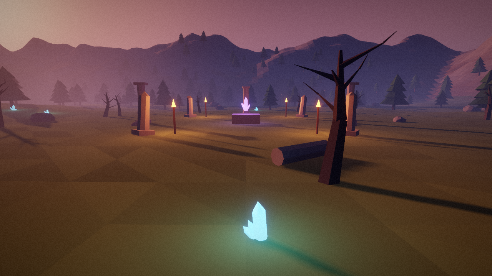

# Grimora Engine

Motor 3D próprio, escrito em **Rust**, para jogos low poly com visual dark fantasy estilizado. Construído para ser desenvolvido junto com IA: cenas em arquivos legíveis, recarga automática, capturas de tela e métricas pela linha de comando.



## Começando

Requisitos: Windows 10/11, GPU com Vulkan ou DirectX 12, [Rust](https://rustup.rs) estável.

```bash
cargo run -p sandbox
```

Controles: segure o **botão direito do mouse** e mova para olhar, **WASD** anda, **E/Q** sobe/desce, **Shift** acelera, roda do mouse ajusta a velocidade, **F5** recarrega a cena, **F12** salva uma captura em `screenshots/`, **Esc** sai.

Com o jogo aberto, edite [assets/scenes/sandbox.ron](assets/scenes/sandbox.ron) e salve: a cena recarrega na hora. Se o arquivo tiver um erro, o motor mostra linha e coluna no terminal e continua com a versão anterior.

### Linha de comando (para automação e IA)

```bash
cargo run -p sandbox -- --screenshot screenshots/teste.png
```

```bash
cargo run -p sandbox -- --screenshot shots/vista.png --camera -13,5,-15 --look-at 0,1,0 --size 1280x720
```

```bash
cargo run --release -p sandbox -- --frames 600 --no-vsync
```

| Opção | Efeito |
| --- | --- |
| `--scene <arquivo.ron>` | Cena a carregar |
| `--screenshot <arquivo.png>` | Renderiza, salva a imagem e fecha |
| `--frames <n>` | Fecha após n quadros (padrão 90 com `--screenshot`) |
| `--camera x,y,z` / `--look-at x,y,z` | Posiciona a câmera |
| `--size LxA` | Tamanho da janela |
| `--no-vsync`, `--no-msaa`, `--no-hot-reload` | Benchmark e depuração |

Ao fechar, o motor imprime uma linha de métricas fácil de ler por scripts:

```
[grimora] frames=80 avg_ms=5.55 p95_ms=5.88 max_ms=6.30 draw_calls=33 objects=392 triangles=48296 gpu="NVIDIA GeForce RTX 3060"
```

## Arquitetura

```
crates/
  grimora_core/    tempo, entrada, Transform, Camera, MeshData, Environment (luz/névoa/céu/pós)
  grimora_render/  renderizador wgpu: sombras, HDR + MSAA 4x, névoa de altura, bloom, tonemapping
  grimora_scene/   formato de cena RON, terreno procedural, geradores low poly, espalhamento
  grimora/         janela (winit), laço principal, trait Game, World, FlyCamera, CLI, hot-reload
examples/
  sandbox/         cena de teste do motor
assets/scenes/     cenas .ron
```

Quadro a quadro: mapa de sombra do sol → passe HDR (céu + malhas iluminadas, MSAA) → cadeia de bloom → tonemap ACES, contraste, saturação, vinheta e granulado na tela. Objetos com a mesma malha são desenhados numa única chamada instanciada.

| Componente | Escolha |
| --- | --- |
| Gráficos | `wgpu` 30 (Vulkan/DX12) com shaders WGSL |
| Janela e entrada | `winit` 0.30 |
| Matemática | `glam` 0.34 |
| Cenas | `ron` + `serde` |

### Criando um jogo

```rust
use grimora::prelude::*;

#[derive(Default)]
struct MeuJogo { camera: FlyCamera }

impl Game for MeuJogo {
    fn update(&mut self, ctx: &mut Context) {
        let olhando = self.camera.update(&mut ctx.camera, &ctx.input, ctx.time.delta());
        ctx.set_cursor_grab(olhando);
        if let Some(obj) = ctx.world.find_mut("altar") {
            obj.transform.rotation = Quat::from_rotation_y(ctx.time.elapsed());
        }
    }
}

fn main() -> anyhow::Result<()> {
    let config = EngineConfig { scene: Some("assets/scenes/minha_cena.ron".into()), ..Default::default() };
    grimora::run(config.with_cli()?, MeuJogo::default())
}
```

### Formato de cena

Tudo é dado: ambiente (sol, luz ambiente, névoa, céu, sombras, pós-processamento), câmera, terreno, objetos, espalhamento aleatório com semente e luzes pontuais. Cores em sRGB 0..1, ângulos em graus, distâncias em metros. Malhas disponíveis: `Cube`, `Plane`, `Cylinder`, `Cone`, `Sphere`, `Pine`, `DeadTree`, `Rock`, `Crystal`, `Pillar`. Veja o exemplo comentado em [sandbox.ron](assets/scenes/sandbox.ron).

## Visão

O objetivo inicial é dar suporte a um jogo de mundo aberto com visual low poly dark fantasy estilizado, priorizando iluminação, atmosfera e identidade em vez de realismo.

Diretrizes:

- Motor próprio, sem Unreal, Godot, Unity ou Three.js como base; bibliotecas especializadas são bem-vindas.
- Sem editor visual como objetivo inicial: cenas e configurações vivem em arquivos de texto.
- Adequado ao desenvolvimento com IA: executar cenas, ler erros e métricas e capturar imagens pela linha de comando.
- Plataforma inicial: Windows para PC.
- Caminho aberto para mundo aberto 3D e para servir de base a outros jogos.

## Roteiro

**Feito (v0.1)**
- [x] Renderizador wgpu: HDR, MSAA 4x, sombra direcional com PCF e estabilização, névoa de altura com dispersão do sol, céu procedural, até 32 luzes pontuais com cintilação, materiais emissivos, bloom, tonemapping ACES e gradação de cor
- [x] Cenas RON com hot-reload, terreno procedural e geradores de props low poly
- [x] Capturas, posicionamento de câmera e métricas por linha de comando

**Próximos passos**
- [ ] Física e colisão (avaliar Rapier; Jolt via bindings se necessário)
- [ ] Importação de modelos glTF (personagens e props feitos em Blender)
- [ ] Personagem controlável em terceira pessoa com câmera orbital
- [ ] Culling por frustum e LOD
- [ ] Animação esquelética
- [ ] Áudio (avaliar `kira`)
- [ ] Mundo em regiões com carregamento por streaming
- [ ] Salvamento de jogo
- [ ] Cascaded shadow maps para sombras nítidas a grandes distâncias
- [ ] ECS (avaliar `hecs` ou `bevy_ecs` quando a quantidade de sistemas justificar)

## Em aberto

- Hardware de referência e critérios de desempenho da primeira versão.
- Licença do projeto.
- Verificação do nome Grimora, caso seja necessário para publicação.
