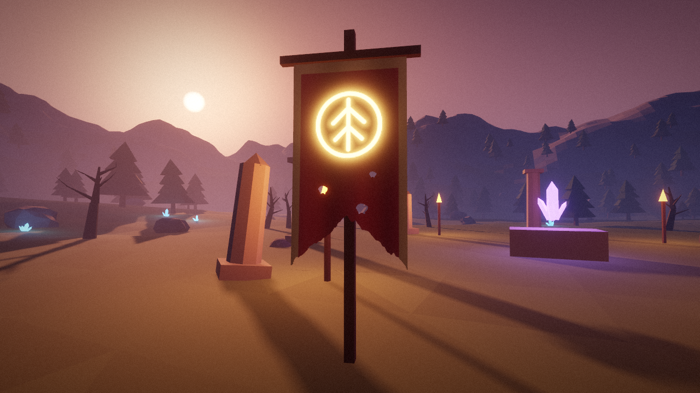
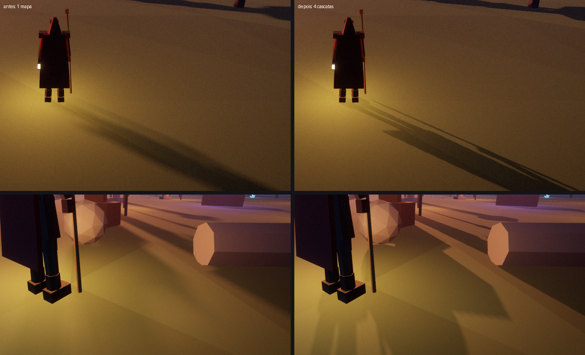

# Grimora Engine

Motor 3D próprio, escrito em **Rust**, para jogos low poly com visual dark fantasy estilizado. Construído para ser desenvolvido junto com IA: cenas em arquivos legíveis, recarga automática, capturas de tela e métricas pela linha de comando.


## Começando

Requisitos: Windows 10/11, GPU com Vulkan ou DirectX 12, [Rust](https://rustup.rs) estável.

```bash
cargo run -p sandbox
```

Você controla um andarilho encapuzado com uma lanterna:

| Tecla | Modo personagem (padrão) | Modo voo (**Tab** alterna) |
| --- | --- | --- |
| Mouse | gira a câmera | segure o botão direito para olhar |
| WASD | anda relativo à câmera | voa |
| Shift | corre | acelera |
| Espaço | pula | sobe (E/Q também) |
| Roda | aproxima/afasta a câmera | ajusta a velocidade |

**F5** recarrega a cena, **F6** salva o jogo, **F9** carrega o último save, **F12** salva uma captura em `screenshots/`, **Esc** sai.


Com o jogo aberto, edite [assets/scenes/sandbox.ron](assets/scenes/sandbox.ron) e salve: a cena recarrega na hora. Se o arquivo tiver um erro, o motor mostra linha e coluna no terminal e continua com a versão anterior.

### Linha de comando (para automação e IA)

```bash
cargo run -p sandbox -- --screenshot screenshots/teste.png
```

```bash
cargo run -p sandbox -- --screenshot shots/vista.png --camera -13,5,-15 --look-at 0,1,0 --size 1280x720
```

```bash
cargo run --release -p sandbox -- --frames 600 --no-vsync
```

| Opção | Efeito |
| --- | --- |
| `--scene <arquivo.ron>` | Cena a carregar |
| `--screenshot <arquivo.png>` | Renderiza, salva a imagem e fecha |
| `--frames <n>` | Fecha após n quadros (padrão 90 com `--screenshot`) |
| `--camera x,y,z` / `--look-at x,y,z` | Posiciona a câmera (Y absoluto; no sandbox, ativa o modo voo) |
| `--size LxA` | Tamanho da janela |
| `--no-vsync`, `--no-msaa`, `--no-hot-reload` | Benchmark e depuração |
| `--no-audio` | Sem som (com `--screenshot` o áudio já roda mudo, sem abrir o dispositivo) |
| `--save-dir <pasta>` | Pasta dos saves (padrão: `%APPDATA%\<título do jogo>\saves`) |
| `--load <slot>` | Pede ao jogo para carregar esse save ao abrir (o sandbox atende) |

Ao fechar, o motor imprime uma linha de métricas fácil de ler por scripts:

```
[grimora] frames=80 avg_ms=5.56 p95_ms=5.88 max_ms=5.91 draw_calls=47 objects=151 culled=249 shadow_casters=305 triangles=28220 gpu="NVIDIA GeForce RTX 3060"
```

`objects` são os objetos desenhados na tela, `culled` os que ficaram de fora (fora da câmera ou pequenos demais) e `shadow_casters` os desenhados no mapa de sombra.

## Arquitetura

```
crates/
  grimora_core/    tempo, entrada, Transform, Camera, MeshData, Material, Environment (luz/névoa/céu/pós)
  grimora_render/  renderizador wgpu: sombras, HDR + MSAA 4x, materiais PBR, névoa de altura, bloom, tonemapping
  grimora_scene/   formato de cena RON, importação glTF, terreno procedural, geradores low poly, espalhamento, colisores
  grimora_physics/ física com Rapier: mundo estático da cena, corpos dinâmicos, raycasts, corpo de personagem (cápsula)
  grimora_audio/   som com kira: efeitos, loops de ambiente e emissores 3D que seguem a câmera
  grimora/         janela (winit), laço principal, trait Game, World, FlyCamera, ThirdPersonController, CLI, hot-reload
examples/
  sandbox/         cena de teste do motor
assets/scenes/     cenas .ron
assets/models/     modelos glTF (com a licença de cada um)
assets/sounds/     sons WAV/OGG (os do sandbox são gerados por tools/gen_sounds.py)
```

Quadro a quadro: mapa de sombra do sol → passe HDR (céu + malhas iluminadas, MSAA) → cadeia de bloom → tonemap ACES, contraste, saturação, vinheta e granulado na tela. Objetos com a mesma malha são desenhados numa única chamada instanciada.

| Componente | Escolha |
| --- | --- |
| Gráficos | `wgpu` 30 (Vulkan/DX12) com shaders WGSL |
| Janela e entrada | `winit` 0.30 |
| Matemática | `glam` 0.34 |
| Física e colisão | `rapier3d` 0.36 |
| Cenas | `ron` + `serde` |
| Modelos | `gltf` 1.4 |
| Áudio | `kira` 0.12 (WAV e OGG) |

### Criando um jogo

```rust
use grimora::prelude::*;

#[derive(Default)]
struct MeuJogo { jogador: Option<ThirdPersonController> }

impl Game for MeuJogo {
    fn scene_loaded(&mut self, ctx: &mut Context) {
        let inicio = ctx.world.player_spawn.expect("a cena define `player`");
        self.jogador = Some(ThirdPersonController::new(inicio.position, inicio.yaw));
    }

    fn update(&mut self, ctx: &mut Context) {
        let Some(jogador) = &mut self.jogador else { return };
        // Anda, pula e colide com a cena; a câmera segue sem atravessar paredes.
        jogador.update(&ctx.input, &mut ctx.physics, &mut ctx.camera, ctx.time.delta());
        ctx.set_cursor_grab(true);
        if let Some(obj) = ctx.world.find_mut("altar") {
            obj.transform.rotation = Quat::from_rotation_y(ctx.time.elapsed());
        }
    }
}

fn main() -> anyhow::Result<()> {
    let config = EngineConfig { scene: Some("assets/scenes/minha_cena.ron".into()), ..Default::default() };
    grimora::run(config.with_cli()?, MeuJogo::default())
}
```

### Formato de cena

Tudo é dado: ambiente (sol, luz ambiente, névoa, céu, sombras, pós-processamento), câmera, ponto de início do jogador, terreno, objetos, espalhamento aleatório com semente e luzes pontuais. Todo objeto colide automaticamente com uma forma adequada (tronco para árvores, casco convexo para rochas e pilares, malha exata para o terreno); use `collider: None` para decoração ou escolha `Box(...)`, `Cylinder(...)`, `Ball(...)`, `Hull` ou `Mesh`. Com `body: Dynamic(...)` o objeto entra na simulação: cai, rola e é empurrado pelo personagem; campos opcionais `density` (kg/m³, padrão 1000) ou `mass` (kg), `friction` (0.6), `restitution` (0) e `angular_damping` (0.5). Malhas exatas viram casco convexo em corpos dinâmicos. Cores em sRGB 0..1, ângulos em graus, distâncias em metros. Malhas disponíveis: `Cube`, `Plane`, `Cylinder`, `Cone`, `Sphere`, `Pine`, `DeadTree`, `Rock`, `Crystal`, `Pillar`, `Wanderer` e `Model(path: "...")`. Veja o exemplo comentado em [sandbox.ron](assets/scenes/sandbox.ron).

### Modelos glTF

Exporte do Blender como glTF 2.0 (`.gltf` + `.bin` + texturas, ou `.glb`) para `assets/models/` e use na cena:

```ron
(mesh: Model(path: "../models/banner/banner.gltf"), position: (-2.6, 0.0, 9.0), rotation: (0.0, 15.0, 0.0)),
```



- O caminho é relativo ao arquivo de cena. Se o arquivo faltar ou estiver quebrado, o erro vai para o log e aparece um cubo magenta no lugar.
- A cena inteira do arquivo vira uma malha: transformações dos nós são aplicadas e cada primitiva vira uma submalha com seu material.
- Materiais metallic-roughness: cor base, normal map, metal/rugosidade, oclusão, emissão (`emissiveFactor`, `emissiveTexture` e `KHR_materials_emissive_strength`) e `doubleSided`. Cores de vértice também são lidas. Faltando normais ou tangentes, o motor gera.
- Emissão acima de 1 alimenta o bloom: no Blender, aumente a força (Strength) do Emission para a runa ou brasa brilhar.
- Transparência (`alphaMode`): `MASK` recorta o que estiver abaixo do `alphaCutoff` (folhagem, pano rasgado, grades), com bordas suavizadas pelo MSAA (alpha-to-coverage) e recorte também na sombra. `BLEND` é aproximado por alpha-to-coverage: não precisa ordenar objetos, mas tem poucos níveis de transparência e um leve pontilhado; para vidro e água de verdade ainda falta mistura ordenada.
- Texturas maiores que `max_texture_size` (padrão 2048) são reduzidas pela metade até caber: `Model(path: "...", max_texture_size: 1024)`.
- O modelo mantém a origem e a escala do arquivo. O colisor automático é o casco convexo; use `collider: Mesh` para formas côncavas grandes (casas, ruínas) ou `None` para decoração.
- Modelos ficam em cache enquanto o arquivo não muda, então o hot-reload da cena é instantâneo. Editar só o modelo não recarrega a cena: salve o `.ron` para recarregar.
- Ainda não suportados: mistura de transparência ordenada, morph targets e um segundo conjunto de UVs.
- O estandarte do sandbox é gerado por [tools/gen_banner.py](tools/gen_banner.py) (Python puro), um exemplo de como criar um glTF por código.

### Animação esquelética

Modelos glTF com esqueleto (skin) e animações tocam direto: o skinning roda na GPU (até 4 ossos por vértice) e cada objeto animado ganha um `Animator`.


```ron
(mesh: Model(path: "../models/wanderer/wanderer.gltf"), position: (5.6, 0.0, 8.4), animation: "idle"),
```

```rust
// No jogo: escolha o clipe pelo movimento; a troca faz crossfade.
if let Some(animator) = ctx.world.objects[avatar].animator.as_mut() {
    animator.play(if correndo { "run" } else { "walk" }, 0.2);
    animator.speed = velocidade / 4.5; // pés sem deslizar
}
// Prenda coisas aos ossos (luz, arma, partículas): transformação no mundo.
if let Some(mao) = ctx.world.joint_transform(avatar, "hand.L") {
    ctx.world.lights[luz].position = mao.position;
}
```

- `Animator`: `play` (em laço) e `play_once` (segura o último quadro; veja `finished`), crossfade suave, `speed`, `stop` volta à pose de repouso, `joint_transform` dá a pose de um osso no espaço do modelo.
- Usa a primeira skin do arquivo. Malhas filhas de um osso (uma espada na mão, por exemplo) seguem o osso sem precisar de pesos. Interpolação step, linear e cubic spline (esta aproximada por linear).
- Exporte do Blender com "Animation" ligado e cada ação como um clipe (NLA ou "Actions"); os nomes dos clipes são os das ações. Animação de nós que não são ossos é ignorada.
- O andarilho do sandbox vem de [tools/gen_wanderer.py](tools/gen_wanderer.py): 17 ossos (o último segura a lanterna) e os clipes `idle`, `walk`, `run` e `jump`, todos no lugar (o movimento vem do controlador).

### Áudio

Sons em loop fazem parte da cena. Sem `position`, o som é ambiente (igual em todo lugar); com `position`, ele vira um emissor 3D: volume cheio até `min_distance`, cai pela distância (-6 dB a cada vez que ela dobra) e some em `max_distance`, com o pan acompanhando a câmera. Com terreno, `y` é medido a partir do chão. Objetos também carregam um som, como carregam uma luz; aí `position` é um deslocamento a partir do objeto:

```ron
sounds: [
    (path: "../sounds/wind.wav", volume: 0.35),
    (path: "../sounds/hum.wav", position: (0.0, 1.6, 0.0), volume: 0.4, min_distance: 2.0, max_distance: 14.0),
],
objects: [
    (mesh: Cone(segments: 5), position: (4.5, 1.7, 6.0), sound: (path: "../sounds/fire.wav", position: (0.0, 0.3, 0.0))),
],
```

No jogo, use `ctx.audio` (volumes são ganhos lineares, 1 = como gravado):

```rust
ctx.audio.play("assets/sounds/step_1.wav", 0.5);                       // efeito único
ctx.audio.play_at("assets/sounds/fire.wav", 1.0, Emitter::at(posicao)); // efeito único no mundo
let vento = ctx.audio.play_loop("assets/sounds/wind.wav", 0.3);         // loop ambiente
let tocha = ctx.audio.play_loop_at("assets/sounds/fire.wav", 0.8, Emitter::at(posicao));
if let Some(id) = tocha { ctx.audio.set_position(id, nova_posicao); }   // e ctx.audio.stop(id)
ctx.audio.set_volume(Category::Ambient, 0.5);                           // e set_master_volume
```

- Arquivos ficam em cache pelo caminho; se o arquivo mudar no disco, é lido de novo no próximo uso.
- A cada (re)carga da cena, os loops da cena são trocados: os que não mudaram continuam tocando sem reiniciar, os removidos somem com fade. Loops iniciados pelo jogo ficam até `stop(id)`.
- Sem dispositivo de áudio, o motor avisa no log e segue mudo. Capturas (`--screenshot`) carregam e mixam tudo, mas não tocam nada.
- Os sons do sandbox (vento, fogo, zumbido do cristal e passos) são sintetizados por [tools/gen_sounds.py](tools/gen_sounds.py) (Python puro, sementes fixas): `python -I tools/gen_sounds.py`.

### Mundos grandes: culling e LOD

O renderizador só desenha o que aparece: cada objeto é testado contra o campo de visão da câmera e, para a sombra, contra o volume coberto pelo sol (assim árvores atrás da câmera ainda projetam sombra na tela). Objetos menores que ~1,5 pixel são pulados (`RendererSettings::min_screen_size`).

Malhas podem ter versões mais simples para quando o objeto aparece pequeno na tela:

```rust
let arvore = pinheiro_detalhado.with_lods([(0.04, pinheiro_simples)]); // abaixo de 4% da altura da tela
```

Pinheiros, árvores mortas e rochas geradas já vêm com um LOD de mesmo contorno. A cena [bench_forest.ron](assets/scenes/bench_forest.ron) (23 mil objetos, 2 milhões de triângulos) serve de referência, numa RTX 3060 em 1280x720:

| | Antes | Culling | Culling + LOD |
|---|---|---|---|
| Visão do jogador | 4,1 ms | 2,9 ms | 2,3 ms |
| Visão aérea | 3,9 ms | 3,4 ms | 2,5 ms |

```bash
cargo run --release -p sandbox -- --scene assets/scenes/bench_forest.ron --no-vsync --frames 600 --screenshot screenshots/bench.png
```

### Sombras em cascata

A sombra do sol usa até 4 mapas de 2048², cada um cobrindo da câmera até uma distância maior (por padrão ~8, 18, 38 e 120 m). Perto do personagem um texel de sombra mede pouco mais de 1 cm; longe, ~14 cm. Nas emendas, uma cascata se mistura com a próxima, e a última some aos poucos no fim de `distance`.

```ron
shadows: (enabled: true, distance: 120.0, strength: 0.85, cascades: 4),
```

- Cada mapa envolve uma esfera, cujo tamanho não muda quando a câmera gira, e se move em passos de um texel: as bordas das sombras não tremem.
- Cada cascata desenha só os objetos dentro do seu volume (incluindo até 100 m na direção do sol, para árvores fora da tela que ainda fazem sombra), pula os menores que um texel e escolhe o LOD pelo tamanho do objeto no mapa.
- `shadow_casters` nas métricas conta um objeto uma vez por cascata em que aparece.



No `bench_forest.ron`, as 4 cascatas custam cerca de 0,5 ms a mais que o mapa único antigo, que chegava só a ~60 m e era bem mais borrado.

### Streaming: mundo em células e regiões

Com `streaming` na cena, só o que está perto da câmera existe de fato (desenhado, iluminado e sólido):

```ron
streaming: (cell_size: 32.0, load_distance: 150.0),
regions: [
    (path: "regions/shrine.ron", center: (-55.0, 0.0, -60.0), radius: 10.0),
],
```

- **Células:** os objetos do `scatter` são distribuídos numa grade de `cell_size` metros. As células a menos de `load_distance` da câmera entram no mundo (até 8 por quadro, as mais próximas primeiro) e saem um pouco mais longe do que entraram, para não piscarem na borda. Objetos de `objects` ficam sempre carregados.
- **Regiões:** pedaços da cena em arquivos `.ron` próprios ([regions/shrine.ron](assets/scenes/regions/shrine.ron) no sandbox), com `objects`, `scatter`, luzes e sons. Quando a câmera chega a `load_distance` do círculo (`center`, `radius`), o arquivo é lido e montado numa thread separada e entra no mundo sem travar o quadro; ao se afastar, sai com colisores, luzes e sons. As malhas de uma região voltam a ser usadas se ela carregar de novo. Um arquivo com erro aparece uma vez no log e é ignorado até a cena recarregar.
- **Terreno:** é cortado em blocos de 32×32 quadrados, cada um com seu colisor, para o culling descartar o que está fora da tela.
- **Luzes:** o renderizador usa as 32 luzes pontuais mais próximas da câmera, então um mundo grande pode ter quantas quiser.
- Deixe `load_distance` além do ponto em que a névoa apaga tudo (cerca de `4 / fog.density`), senão a borda do mundo carregado aparece em vistas aéreas.
- No código: `World::all_objects()` percorre objetos fixos e carregados; `World::streaming_stats()` diz quanto está carregado; `World::load_around(ponto, physics)` carrega tudo de uma vez (útil em testes e teletransportes).

Em [bench_forest.ron](assets/scenes/bench_forest.ron) (`load_distance: 450`, mesma máquina da tabela acima), o quadro na visão do jogador cai de 2,3 ms para 1,35 ms (medido antes das sombras em cascata), com 188 de 315 células carregadas. A carga inicial das células leva ~2 ms.

### Salvamento de jogo

Cada save é um arquivo RON legível num slot (`quick.ron`, `slot_1.ron`...). O jogo decide o que guardar do próprio estado; o motor junta a câmera e os objetos da cena que mudaram:

```rust
#[derive(Serialize, Deserialize)]
struct MeuSave { jogador: CharacterState, ouro: u32 }

ctx.save_game("slot_1", &MeuSave { jogador: player.state(), ouro: self.ouro })?;

let save: MeuSave = ctx.load_game("slot_1")?;
player.restore(&save.jogador);
self.ouro = save.ouro;
```

- **O que o motor guarda sozinho:** a câmera e cada objeto da cena (`objects` do `.ron`) que foi movido, escondido (`visible = false`) ou ainda está rolando, com a velocidade dos corpos dinâmicos. Objetos que não mudaram ficam de fora, então o save é pequeno.
- **Ao carregar:** os objetos da cena voltam para onde o arquivo da cena os colocou, as mudanças salvas são aplicadas por cima (caixas empurradas voltam com física e tudo), a câmera volta e o conteúdo de streaming é recarregado em volta dela.
- **Fica com o jogo:** objetos criados pelo jogo (`World::spawn`) e o personagem (`ThirdPersonController::state()`/`restore()` dão um `CharacterState` pronto para salvar).
- **Segurança:**
  - A gravação é atômica: o arquivo novo só substitui o antigo depois de inteiro no disco.
  - Um save feito em outra cena é recusado sem mexer em nada.
  - Um objeto salvo cujo nome não bate mais com a cena (porque o `.ron` mudou) é pulado com aviso.
  - Campos novos no estado do jogo com `#[serde(default)]` mantêm saves antigos válidos.
- **Slots:** `ctx.saves` (`SaveStore`) lista os slots do mais recente ao mais antigo, apaga e lê/grava qualquer valor serializável (útil também para configurações).
- **Limitação:** objetos espalhados por streaming (`scatter` com `streaming`) não são salvos; voltam ao estado da cena quando a célula recarrega.

## Visão

O objetivo inicial é dar suporte a um jogo de mundo aberto com visual low poly dark fantasy estilizado, priorizando iluminação, atmosfera e identidade em vez de realismo.

Diretrizes:

- Motor próprio, sem Unreal, Godot, Unity ou Three.js como base; bibliotecas especializadas são bem-vindas.
- Sem editor visual como objetivo inicial: cenas e configurações vivem em arquivos de texto.
- Adequado ao desenvolvimento com IA: executar cenas, ler erros e métricas e capturar imagens pela linha de comando.
- Plataforma inicial: Windows para PC.
- Caminho aberto para mundo aberto 3D e para servir de base a outros jogos.

## Roteiro

**Feito (v0.1)**
- [x] Renderizador wgpu: HDR, MSAA 4x, sombra direcional com PCF e estabilização (4 cascatas), névoa de altura com dispersão do sol, céu procedural, até 32 luzes pontuais com cintilação, materiais emissivos, bloom, tonemapping ACES e gradação de cor
- [x] Cenas RON com hot-reload, terreno procedural e geradores de props low poly
- [x] Capturas, posicionamento de câmera e métricas por linha de comando
- [x] Colisão com Rapier: terreno, props e colisores declarados na cena
- [x] Personagem em terceira pessoa: andar, correr, pular, degraus e rampas; câmera orbital que não atravessa paredes
- [x] Importação de modelos glTF com materiais PBR (texturas de cor, normal, metal/rugosidade e oclusão, com mipmaps)
- [x] Transparência recortada (`alphaMode: Mask`) com alpha-to-coverage e sombras recortadas; mapas de emissão
- [x] Corpos dinâmicos: objetos que caem, rolam e são empurrados pelo personagem
- [x] Animação esquelética: skinning na GPU, clipes glTF com crossfade e objetos presos a ossos
- [x] Áudio com `kira`: efeitos, loops de ambiente e emissores 3D na cena, passos do personagem

- [x] Culling por frustum (câmera e sombra), descarte de objetos minúsculos e LOD por tamanho na tela
- [x] Mundo em células e regiões com carregamento por streaming (regiões montadas em segundo plano)
- [x] Salvamento de jogo: slots em RON com gravação atômica, estado do jogo + objetos e corpos da cena

**Próximos passos**
- [ ] ECS (avaliar `hecs` ou `bevy_ecs` quando a quantidade de sistemas justificar)

## Em aberto

- Hardware de referência e critérios de desempenho da primeira versão.
- Licença do projeto.
- Verificação do nome Grimora, caso seja necessário para publicação.
