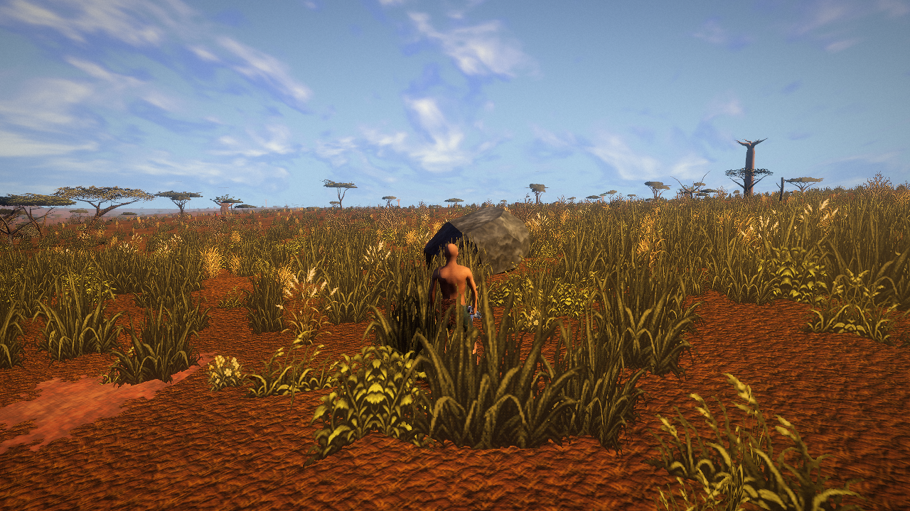
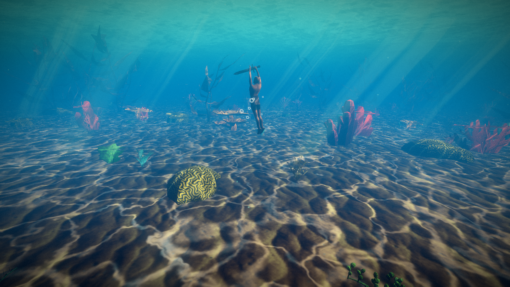
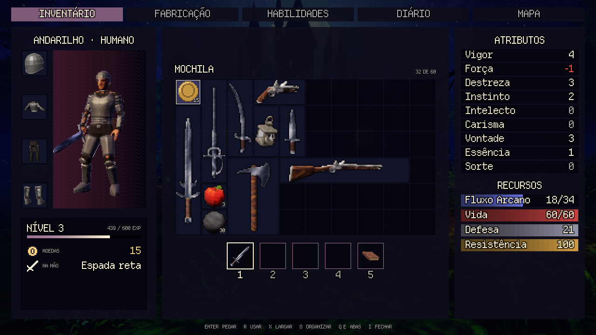

# Grimora Engine

Motor 3D próprio em Rust (wgpu, winit, glam, Rapier, kira, hecs) feito para **Nyraldar**, um jogo de mundo aberto num mundo próprio dos séculos XVII–XVIII, com visual PSX onírico e surreal. Todo o desenvolvimento é feito com IA: cenas, mundos e configurações vivem em arquivos de texto, e tudo pode ser rodado, medido e capturado pela linha de comando.





## O que existe hoje

**Mundo gerado** — a ilha de teste de Nyraldar sai de um mapa macro e de uma semente:
- Relevo em f64 com costa fractal, praias, falésias em camadas, planalto, vales e fundo do mar em degraus (recifes, queda, mar aberto).
- Terreno em quadtree com streaming em threads, LOD sem buracos e origem flutuante (mundo de muitos km sem perder precisão).
- Hidrologia: riachos que nascem, juntam água, fazem meandros, lagoas, cachoeiras e foz no mar.
- Vida: acácias, baobás, palmeiras, capins, corais e algas espalhados por célula, determinísticos, com colisores perto do jogador.
- Save por diferença: só o que mudou no mundo gerado (planta cortada, coisa movida) vai para o arquivo.

**A vila** — lugar escolhido pelo terreno, ruas orgânicas, largo, roça, cemitério e curral:
- Casas geradas por ofício (taverna, ferreiro, curandeira, pescador, chefe, carpinteiro...), com cômodos, móveis, portas, chaminés, fogo e luz presa ao cômodo.
- Moradores com nome, família, corpo, cabelo e roupas próprios; rotina diária, necessidades, despensa, ferramentas reais, pesca, doença, amizades e desafetos, reputação, roubo e reação à violência.
- Gado no curral com ragdoll, sustos e investidas.

**Fauna** — cardumes, aves que caçam, caranguejos, arraias e águas-vivas com ecologia que roda por dias de jogo.

**Personagem e combate** — terceira pessoa, nado e mergulho, espadas leves e pesadas, combo, esquiva, bloqueio, trava de alvo, armas de fogo de pederneira, grimório e feitiços de gelo, ragdolls ativos e nocaute.

**Renderização** — HDR, sombras em cascata, LOD e culling, ciclo de dia e noite com clima (chuva, tempestade, neve, raios), vento com rajadas, mar com ondas de Gerstner, cáusticas e visão submersa, névoa atmosférica, partículas em camadas, auras e fogo volumétrico.

**Interface** — HUD e menus no estilo "Menu de Sonho" (PS1), inventário em grade, equipamento no corpo, diálogo, diário, lojas, fogueira e retratos 3D.

**Ferramentas** — animador de poses (`examples/animator`), visualizador do mapa (`world_map`), gerador de ícones (`icon_maker`) e scripts Python/Blender em `tools/`.



## Começando

Requer Rust estável (veja `rust-toolchain.toml`) e uma GPU com suporte a Vulkan/DX12.

```bash
cargo run --release -p sandbox -- --world assets/world/island.ron
```

Comandos úteis:

```bash
cargo build -p sandbox
cargo test --workspace
cargo clippy --workspace --all-targets
cargo fmt --all
```

Capturas e métricas sem abrir janela:

```bash
cargo run --release -p sandbox -- --world assets/world/island.ron --screenshot screenshots/check.png --size 1280x720 --time 12
cargo run --release -p sandbox -- --world assets/world/island.ron --screenshot screenshots/reef.png --at 4477.1,1682.2 --camera -6,-6,6 --look-at 6,-10,-6
```

Outras opções: `--camera x,y,z --look-at x,y,z`, `--time <hora>`, `--start-time <hora>`, `--weather`, `--menu <tela>`, `--no-ui`, `--no-vsync`, `--frames N`, `--save-dir`/`--load`. A última linha impressa (`[grimora] frames=... avg_ms=...`) traz o desempenho.

Controles principais: WASD andar, Shift correr, Alt andar devagar, Espaço pular, clique golpear, botão direito defender, Q travar alvo, E interagir, I inventário, J diário, F1 menu de debug, F5 trocar o clima, Esc pausa.

## Organização

```
crates/
  grimora_core     tipos compartilhados: tempo, entrada, câmera, malhas, animação, água, vento, partículas, dia/noite
  grimora_render   renderizador wgpu e shaders WGSL, HUD
  grimora_scene    formato RON de cenas, glTF, texturas, casas, itens, história, fauna (dados)
  grimora_world    mundo gerado: mapa macro, relevo, água doce, vida, vila, moradores
  grimora_physics  Rapier: colisão, personagem, ragdolls, busca de caminho
  grimora_audio    kira: som 3D com oclusão
  grimora          laço principal, World (hecs), streaming, saves, NPCs, combate, fauna, vila
examples/
  sandbox          o jogo de teste
  animator         editor de animações por poses
  world_map        visualizador do mapa macro
  icon_maker       ícones e imagens de itens
assets/            cenas, mundo, modelos, texturas, sons, efeitos, itens, história
tools/             importadores e geradores (Python e Blender)
docs/              notas de projeto e imagens deste README
```

O mapa detalhado do código, com as decisões de cada sistema, está em [CLAUDE.md](CLAUDE.md).

## Diretrizes

- Motor próprio, sem Unreal, Godot ou Unity como base; bibliotecas especializadas são bem-vindas.
- Sem editor visual: tudo é texto, semente e linha de comando.
- Tudo procedural recebe semente; a mesma semente gera o mesmo mundo.
- Nada imaginário na simulação: moradores e animais só sabem o que perceberam e só usam o que existe.
- Plataforma inicial: Windows.

## Próximos passos

- Crime, morte e luto, e memória dos moradores.
- Mais clipes da vida da vila (comer, martelar, varrer, carregar).
- Fauna e plantas nas regiões distantes; sistema de navegação de verdade para animais e NPCs.
- O resto do mundo de Nyraldar além da ilha de teste.

## Créditos

Veja [CREDITS.md](CREDITS.md).
